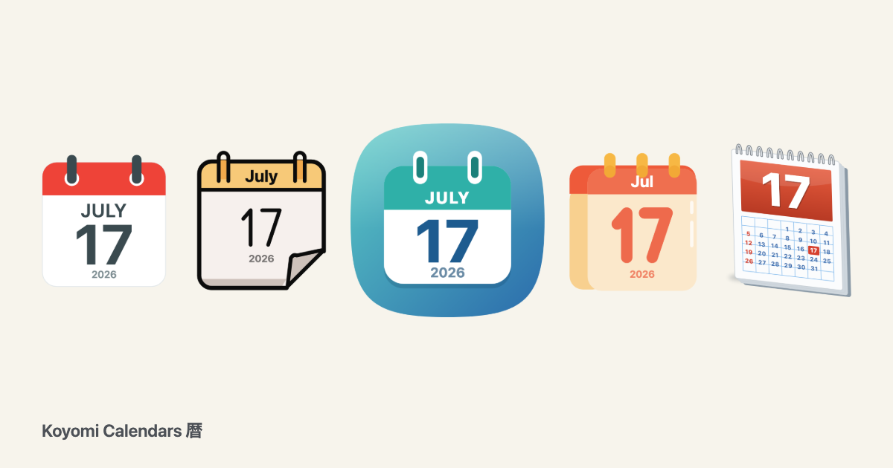
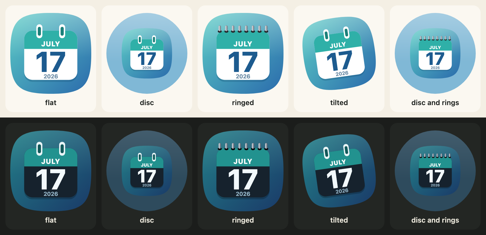
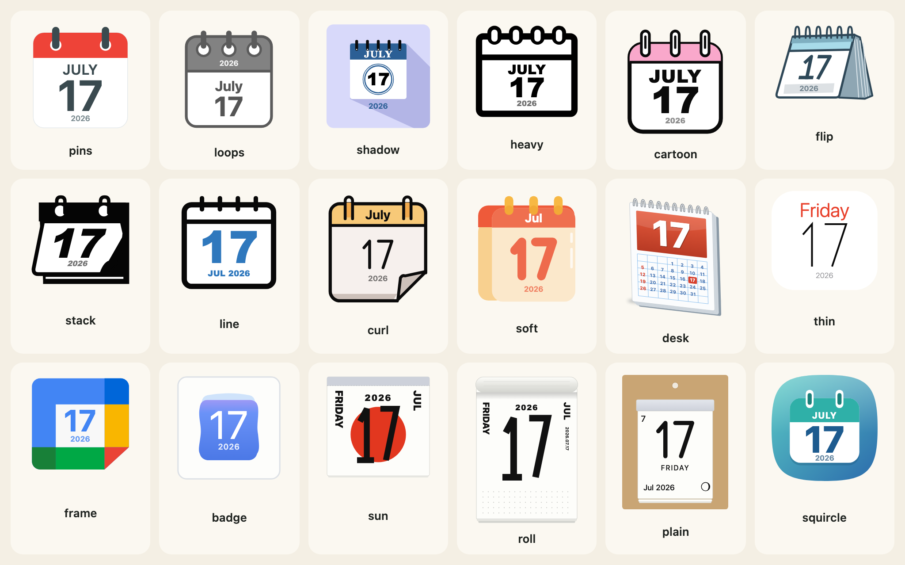
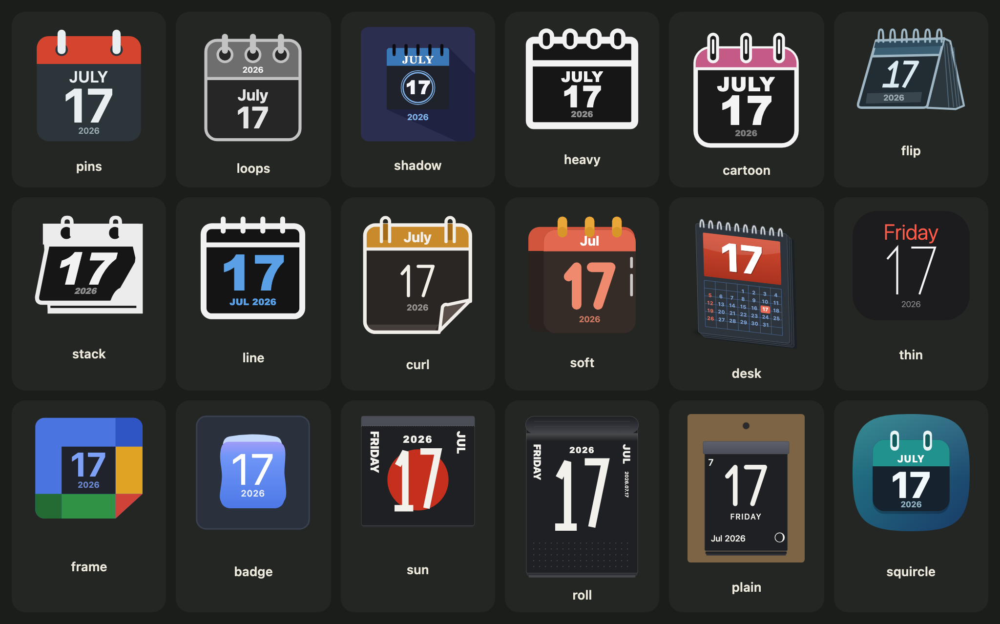
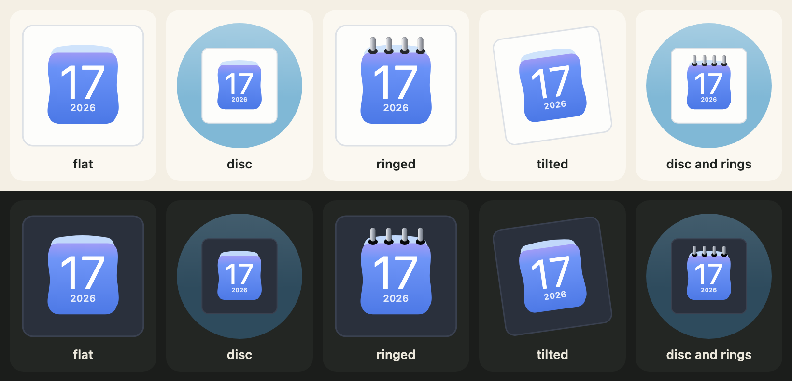
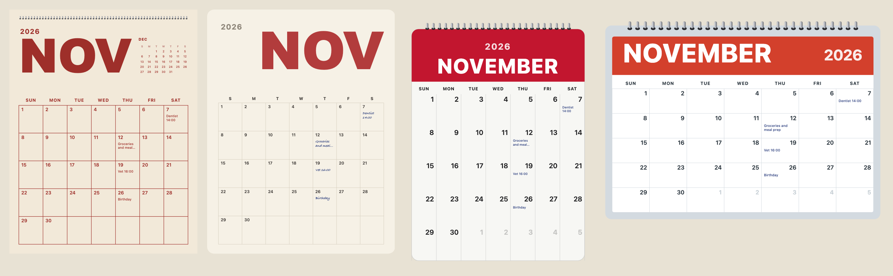
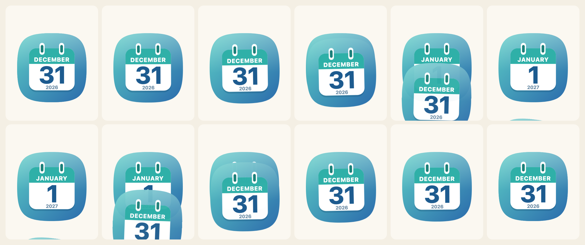
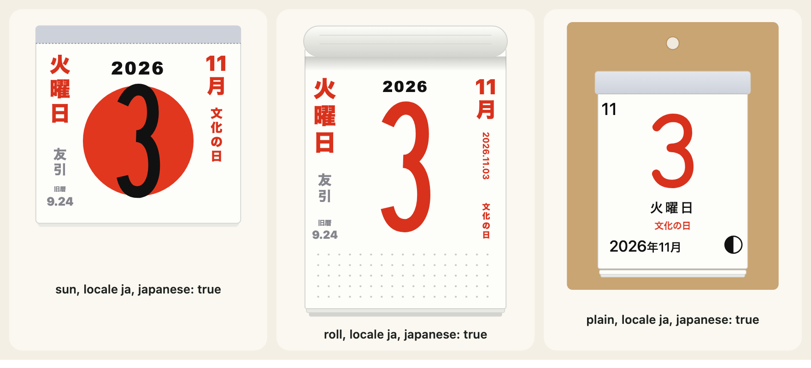

<p align="center"><a href="https://johnmorrisdotca.github.io/koyomi-calendars/"><picture><source media="(prefers-color-scheme: dark)" srcset="https://raw.githubusercontent.com/johnmorrisdotca/koyomi-calendars/main/docs/images/thumbnail-dark.png"></picture></a></p>

<p align="center"></p>

# Koyomi Calendars <sub>暦</sub>

**Calendar pages as SVG, in under 10 kB.** One day as an icon, in 18 original designs, light and dark. A whole month as a poster, a memo board, a wall page or a desk pad. And the page turning, from one day to the next and back.

<p align="center">
  <a href="https://github.com/johnmorrisdotca/koyomi-calendars/actions/workflows/pages.yml"></a>
  <a href="https://www.npmjs.com/package/@johnmorrisdotca/koyomi-calendars"></a>
  
  
  
</p>

## In 30 seconds

```sh
npm install @johnmorrisdotca/koyomi-calendars
```

```js
import { calendarIcon } from "@johnmorrisdotca/koyomi-calendars";

const svg = calendarIcon({ theme: "squircle", month: 11, day: 2, year: 2026, scheme: "dark", housing: "circle", rings: true });
console.log(svg.startsWith("<svg")); // true
```

**[Open the demo](https://johnmorrisdotca.github.io/koyomi-calendars/)** ([日本語のデモ](https://johnmorrisdotca.github.io/koyomi-calendars/ja/)): pick a design, a housing, rings and a turn, turn the page back and forward, and copy the code. The [builder](https://johnmorrisdotca.github.io/koyomi-calendars/builder.html) does the same for a whole setup, in a page of its own. Both have the family's "Put it in your page" panel: the code for a page, one design alone, a file on a server, plain HTML, React, Vue, Angular, Svelte and an iframe, the picture beside it, Copy, the embed page and the docs.

## Who it is for

- An app, a site or a dashboard that wants a date as a picture: a today icon, a calendar tile, a month on a page, an event's day.
- A server that has to draw a calendar page for an email, a share card or a PDF, with no browser and no image library.
- A page in Japanese, with the holidays, the old calendar and the six-day cycle on a tear-off page, computed and never looked up.
- A product that wants the small icon to stay small: each design is its own import.

## Features

- **18 designs, light and dark.** Every one is our own drawing: shapes, gradients and a stroke-drawn digit set. No image, no font file, no logo, no company's name.
- **Small.** One design alone is about 9 kB minified (4 kB gzipped), and imports nothing else. Import a design from `@johnmorrisdotca/koyomi-calendars/themes/squircle` and the other 17 never reach the page. All 18 together are about 49 kB.
- **Housing, rings and a turn.** Set the icon on a disc, bind it with spiral rings, stand it a little askew like older macOS icons, or take a named preset: `flat`, `disc`, `ringed`, `tilted`, `disc-ringed`.
- **Any language.** Month and weekday words come from `Intl`; Japanese, with the Japanese holidays, the old calendar and the six-day cycle, is computed, never looked up.
- **Whole months.** `monthCalendar` draws four month designs for any month and year, with leap years, a Sunday or Monday week start, notes on days that are yours to give, and no holiday data of its own. A separate import (`/month`, about 11 kB).
- **The page turns.** `flipCalendar` tears the page down, flies it up and away, rips it off a corner or flips it down, forwards or backwards, with `prefers-reduced-motion` respected. A separate import (`/animate`, about 3 kB), with no dependency.
- **No dependency**, no side effect (`"sideEffects": false`), typed, ESM. Node 22 or later, or any current browser.



## Install

```sh
npm install @johnmorrisdotca/koyomi-calendars
```

```sh
pnpm add @johnmorrisdotca/koyomi-calendars
```

Node 22 or later, or any current browser. Everything is an ES module with its types; there is nothing to configure.

## Use it in your project

In a bundler, a framework or a Node program, import what you use:

```js
import { calendarIcon, CALENDAR_THEMES } from "@johnmorrisdotca/koyomi-calendars";

console.log(CALENDAR_THEMES.length); // 18
const svg = calendarIcon({ theme: "pins", month: 7, day: 17, year: 2026, size: 120 });
console.log(svg.includes('viewBox="20 15 273 280"')); // true
```

In TypeScript, the options are typed:

```ts
import { calendarIcon, type CalendarIconOptions } from "@johnmorrisdotca/koyomi-calendars";

const options: CalendarIconOptions = { theme: "squircle", month: 11, day: 2, year: 2026, scheme: "light" };
const svg: string = calendarIcon(options);
```

The result is an SVG string with a `title` and an `aria-label`. Put it in the page with `innerHTML`, write it to a file, or send it from a server. The library never reads the clock: you say the date.

## Use it anywhere

On a page with no bundler, import from a CDN that serves the package's ES modules, or from your own copy of `dist`:

```html
<div id="today"></div>
<script type="module">
  import { calendarIcon } from "https://cdn.jsdelivr.net/npm/@johnmorrisdotca/koyomi-calendars/dist/themes/squircle.js";
  const now = new Date();
  document.querySelector("#today").innerHTML = calendarIcon({ month: now.getMonth() + 1, day: now.getDate(), year: now.getFullYear() });
</script>
```

On a server, in a build script or in a worker, call the same functions and write the string where you need it:

```js
import { calendarIcon } from "@johnmorrisdotca/koyomi-calendars";
import { monthCalendar } from "@johnmorrisdotca/koyomi-calendars/month";

const files = { "today.svg": calendarIcon({ month: 11, day: 2 }), "month.svg": monthCalendar({ year: 2026, month: 11 }) };
console.log(Object.keys(files).join(" ")); // today.svg month.svg
```

## Examples

A whole month with notes, an icon in Japanese and the same icon one design alone:

```js
import { monthCalendar } from "@johnmorrisdotca/koyomi-calendars/month";

const svg = monthCalendar({ year: 2026, month: 11, design: "poster", weekStart: "monday", notes: { "11-07": "Dentist 14:00" } });
console.log(svg.includes("Dentist")); // true
```

```js
import { calendarIcon } from "@johnmorrisdotca/koyomi-calendars/themes/sun";

const page = calendarIcon({ month: 11, day: 3, year: 2026, locale: "ja", japanese: true });
console.log(page.includes('data-part="side"')); // true
```

## The 18 designs

`pins`, `loops`, `shadow`, `heavy`, `cartoon`, `flip`, `stack`, `line`, `curl`, `soft`, `desk`, `thin`, `frame`, `badge`, `sun`, `roll`, `plain` and `squircle`. Every design has a light and a dark version (`scheme: "light"` or `"dark"`). The ten names of the first release (`classic`, `outline` and so on) still work: each reads as the design that replaced it. The list with what each one looks like is in [Icons and designs](https://github.com/johnmorrisdotca/koyomi-calendars/blob/main/docs/guides/icons-and-designs.md).

```js
import { CALENDAR_THEME_LABELS, calendarThemeOf } from "@johnmorrisdotca/koyomi-calendars";

console.log(CALENDAR_THEME_LABELS.sun.en); // Sun disc
console.log(calendarThemeOf("classic")); // pins
```



## Housing, rings and turn

Three options change the whole icon and leave a design's drawing alone; with none of them set, the output is the same bytes as without them.

- `housing: "circle"` sets the icon on a coloured disc; `housingColour` takes any CSS colour. The default is `"square"`: the icon alone.
- `rings: true` draws spiral rings across the top of the page, on the designs that have no binding of their own: `badge`, `frame`, `sun`, `roll`, `plain` and `squircle`. A number (0 to 24) sets how many. The other designs ignore it.
- `turn` turns the whole icon a little, in degrees (-45 to 45; negative is to the left), as older macOS icons stood.

```js
import { calendarIcon } from "@johnmorrisdotca/koyomi-calendars";

const round = calendarIcon({ theme: "badge", month: 3, day: 9, housing: "circle", rings: true, turn: -8 });
console.log(round.includes("<circle")); // true
console.log(round.includes("rotate(-8")); // true
```



## Presets

A preset is a name for a set of those options: `flat`, `disc`, `ringed`, `tilted` and `disc-ringed`. An option you give yourself wins over the preset.

```js
import { calendarIcon, CALENDAR_PRESETS } from "@johnmorrisdotca/koyomi-calendars";

console.log(Object.keys(CALENDAR_PRESETS).join(" ")); // flat disc ringed tilted disc-ringed
const svg = calendarIcon({ theme: "squircle", month: 1, day: 1, preset: "disc-ringed", turn: 0 });
console.log(svg.includes("rotate")); // false
```

## One design alone

Each design is also its own import, which carries none of the others:

```js
import { calendarIcon } from "@johnmorrisdotca/koyomi-calendars/themes/squircle";

const svg = calendarIcon({ month: 11, day: 2 });
console.log(svg.startsWith("<svg")); // true
```

`pnpm check` holds the size of each import to a budget: see [Sizes and bundles](https://github.com/johnmorrisdotca/koyomi-calendars/blob/main/docs/guides/sizes-and-bundles.md).

## A whole month

`monthCalendar` draws a month as a poster, a memo board, a wall page or a desk pad, for any month and year. It is a separate import (`/month`).

```js
import { daysInMonth, monthCalendar, monthGrid, MONTH_DESIGNS } from "@johnmorrisdotca/koyomi-calendars/month";

console.log(MONTH_DESIGNS.join(" ")); // poster board wall desk
console.log(daysInMonth(2024, 2)); // 29
console.log(monthGrid(2026, 2, "monday").weeks.length); // 5
const svg = monthCalendar({ year: 2026, month: 11, design: "wall", notes: { "11-23": "Day off" } });
console.log(svg.includes("Day off")); // true
```



See [Month pages](https://github.com/johnmorrisdotca/koyomi-calendars/blob/main/docs/guides/month-pages.md).

## The page turning

`flipCalendar` turns the icon in an element from one date to the next or back, in four ways. It needs a browser.

```js no-run
import { flipCalendar, nextDay } from "@johnmorrisdotca/koyomi-calendars/animate";
import { calendarIcon } from "@johnmorrisdotca/koyomi-calendars/themes/squircle";

const from = { year: 2026, month: 12, day: 31 };
await flipCalendar(element, { render: (d) => calendarIcon({ ...d }), from, to: nextDay(from), animation: "tear-down" });
```



The four ways are `tear-down`, `fly-up`, `rip-corner` and `flip-down`; the [docs](docs/animate.md) and [Turning the page](https://github.com/johnmorrisdotca/koyomi-calendars/blob/main/docs/guides/turning-the-page.md) show each. The date helpers work anywhere:

```js
import { addDays, compareDays, nextDay } from "@johnmorrisdotca/koyomi-calendars/animate";

console.log(JSON.stringify(nextDay({ year: 2026, month: 12, day: 31 }))); // {"year":2027,"month":1,"day":1}
console.log(JSON.stringify(addDays({ year: 2026, month: 1, day: 31 }, 30))); // {"year":2026,"month":3,"day":2}
console.log(compareDays({ year: 2026, month: 1, day: 1 }, { year: 2026, month: 1, day: 2 })); // 1
```

## The Japanese calendar

The Japanese public holidays (2000 to 2099), the old calendar (1900 to 2100) and the six-day cycle are computed, never looked up, and a date the method cannot settle gives `null`. They are functions in the main import and in `/japanese`, and the tear-off designs `sun`, `roll` and `plain` can write them in their side columns with `japanese: true`.

```js
import { japaneseHoliday, oldCalendarDate, rokuyoOf } from "@johnmorrisdotca/koyomi-calendars/japanese";

console.log(japaneseHoliday(2026, 11, 3)?.en); // Culture Day
console.log(JSON.stringify(oldCalendarDate(2026, 11, 2))); // {"month":9,"day":23,"leap":false}
console.log(rokuyoOf(2026, 11, 2)?.reading); // Senshō
```



The functions are also `japaneseHolidaysOf`, `JAPANESE_HOLIDAY_YEARS`, `OLD_CALENDAR_YEARS` and `ROKUYO`. See [The Japanese calendar](https://github.com/johnmorrisdotca/koyomi-calendars/blob/main/docs/guides/japanese-calendar.md).

## Languages

`locale` is `en` or any locale `Intl` accepts, for the icons and the months. The package ships no list of month or weekday names.

```js
import { calendarIcon } from "@johnmorrisdotca/koyomi-calendars";

const fr = calendarIcon({ theme: "pins", month: 11, day: 2, year: 2026, locale: "fr" });
console.log(fr.includes("lundi")); // true
```

## Frameworks

The package returns text, so it needs no wrapper. In React:

```tsx
import { calendarIcon, type CalendarTheme } from "@johnmorrisdotca/koyomi-calendars";

export function DayIcon({ date, theme = "squircle" }: { date: Date; theme?: CalendarTheme }) {
  const svg = calendarIcon({ theme, month: date.getMonth() + 1, day: date.getDate(), year: date.getFullYear() });
  return <span role="img" aria-label={date.toDateString()} dangerouslySetInnerHTML={{ __html: svg }} />;
}
```

In Vue:

```vue
<script setup>
import { monthCalendar } from "@johnmorrisdotca/koyomi-calendars/month";
const props = defineProps({ year: Number, month: Number });
</script>
<template><div v-html="monthCalendar({ year: props.year, month: props.month })" /></template>
```

Svelte, Angular, a server and a static site are in [Frameworks and servers](https://github.com/johnmorrisdotca/koyomi-calendars/blob/main/docs/guides/frameworks.md).

In a page of any kind, with no script of your own, an iframe of the [embed page](https://johnmorrisdotca.github.io/koyomi-calendars/embed.html) draws what its address says:

```html
<!doctype html>
<html lang="en">
  <head>
    <meta charset="utf-8" />
    <meta name="viewport" content="width=device-width, initial-scale=1" />
    <title>Koyomi Calendars in an iframe</title>
  </head>
  <body>
    <iframe
      src="https://johnmorrisdotca.github.io/koyomi-calendars/embed.html?theme=squircle&date=2026-11-03&scheme=light&preset=disc-ringed"
      title="A calendar page for 3 November 2026"
      width="240"
      height="240"
      loading="lazy"
      style="border: 0"
    ></iframe>
  </body>
</html>
```

The address takes the day, the design, the scheme, a look and a language; the [iframe guide](https://github.com/johnmorrisdotca/koyomi-calendars/blob/main/docs/guides/embed-in-an-iframe.md) lists them all. Vite, webpack, a CDN and TypeScript have their own guides, linked below.

## Theming

`scheme` is `"light"` or `"dark"`; you choose it, for instance from `prefers-color-scheme`, because the library reads nothing. `housingColour` sets a disc's colour, `size` the width, and the page decides where it goes. For a file, make both and let the page choose:

```html
<picture>
  <source media="(prefers-color-scheme: dark)" srcset="today-dark.svg">
  
</picture>
```

See [Accessibility and theming](https://github.com/johnmorrisdotca/koyomi-calendars/blob/main/docs/guides/accessibility-and-theming.md).

```js
import { calendarIcon } from "@johnmorrisdotca/koyomi-calendars";

const svg = calendarIcon({ month: 11, day: 2, scheme: "dark", housing: "circle", housingColour: "#335577", size: 160 });
console.log(svg.includes("#335577")); // true
```

## Accessibility

Every icon and month page is an SVG with `role="img"`, a `title` and an `aria-label` naming the date in its own language. `flipCalendar` respects `prefers-reduced-motion`. Nothing else moves. See the [accessibility guide](https://github.com/johnmorrisdotca/koyomi-calendars/blob/main/docs/guides/accessibility-and-theming.md).

```js
import { calendarIcon } from "@johnmorrisdotca/koyomi-calendars";

const svg = calendarIcon({ month: 11, day: 2, year: 2026 });
console.log(svg.includes('role="img"'), svg.includes("<title>Monday Nov 2 2026</title>")); // true true
```

## Limits

- **Dates are not validated against their month.** `calendarIcon` checks that the day is 1 to 31, not that the month has it; `daysInMonth` knows.
- **Japanese holidays 2000 to 2099, old calendar 1900 to 2100.** Outside those years the answer is `null`.
- **No holiday of any other country.** A month page takes its notes from you.
- **Equinox days are a prediction** for far years: the observatory announces each year's in February of the year before.
- **`flipCalendar` needs a browser** (the Web Animations API) and an element.
- **An unknown locale falls back to English** rather than failing.

For the first limit, the icon is drawn, and `daysInMonth` is how to know:

```js
import { calendarIcon } from "@johnmorrisdotca/koyomi-calendars";
import { daysInMonth } from "@johnmorrisdotca/koyomi-calendars/month";

console.log(calendarIcon({ month: 2, day: 31 }).startsWith("<svg")); // true
console.log(daysInMonth(2026, 2)); // 28
```

## Browser and runtime support

Node 22 or later and any current browser draw icons and months, since the library is string work and `Intl`. `flipCalendar` needs the Web Animations API (every current browser). The demo is played in Chromium and WebKit by `pnpm test:demo`. A runtime with a reduced `Intl` (a small ICU build) knows fewer locales.

## Roadmap

Koyomi is meant to become the family's home for everything calendar: today the icons, the month pages and the page turning; more will arrive in this package, each its own import so the small icon stays small.

## Architecture

Each part is its own import; a design is one file that imports only the shared kit; a drawing is a pure function of its options. The imports, the rules and how an icon is made are in the [architecture guide](https://github.com/johnmorrisdotca/koyomi-calendars/blob/main/docs/guides/architecture.md).

## The API in a list

Main import: `calendarIcon`, `calendarLayout`, `CALENDAR_THEMES`, `CALENDAR_THEME_LABELS`, `CALENDAR_THEME_ALIASES`, `calendarThemeOf`, `CALENDAR_YEAR_MIN`, `CALENDAR_YEAR_CLEAR`, `calendarWeekend`, `calendarMoon`, `CALENDAR_HOUSINGS`, `CALENDAR_TURN_MAX`, `CALENDAR_PRESETS`, `calendarPresetOf`, and the Japanese calendar functions `japaneseHoliday`, `japaneseHolidaysOf`, `JAPANESE_HOLIDAY_YEARS`, `oldCalendarDate`, `OLD_CALENDAR_YEARS`, `ROKUYO` and `rokuyoOf`. Each design alone: `themes/<name>` exports `calendarIcon`. `/animate`: `flipCalendar`, `nextDay`, `previousDay`, `addDays`, `compareDays`, `CALENDAR_FLIPS`. `/month`: `monthCalendar`, `monthGrid`, `daysInMonth`, `MONTH_DESIGNS`. Every export of every import, with its signature, is in the generated [API reference](https://github.com/johnmorrisdotca/koyomi-calendars/blob/main/docs/API.md).

## Documentation

The [documentation site](https://johnmorrisdotca.github.io/koyomi-calendars/docs/) has a page for every export, the guides below in English and Japanese, and search; the [embed page](https://johnmorrisdotca.github.io/koyomi-calendars/embed.html) is made for an iframe.

| Guide | What it covers |
|---|---|
| [Getting started](https://github.com/johnmorrisdotca/koyomi-calendars/blob/main/docs/guides/getting-started.md) | A first icon, a month and a page turn |
| [Icons and designs](https://github.com/johnmorrisdotca/koyomi-calendars/blob/main/docs/guides/icons-and-designs.md) | The 18 designs and every option |
| [Housing, rings and turn](https://github.com/johnmorrisdotca/koyomi-calendars/blob/main/docs/guides/looks.md) | The frame options and the presets |
| [Month pages](https://github.com/johnmorrisdotca/koyomi-calendars/blob/main/docs/guides/month-pages.md) | Four designs, notes, the grid as data |
| [Turning the page](https://github.com/johnmorrisdotca/koyomi-calendars/blob/main/docs/guides/turning-the-page.md) | The four ways, dates, reduced motion |
| [The Japanese calendar](https://github.com/johnmorrisdotca/koyomi-calendars/blob/main/docs/guides/japanese-calendar.md) | Holidays, old calendar, six-day cycle |
| [Languages and locales](https://github.com/johnmorrisdotca/koyomi-calendars/blob/main/docs/guides/languages-and-locales.md) | `Intl` words and fallbacks |
| [Sizes and bundles](https://github.com/johnmorrisdotca/koyomi-calendars/blob/main/docs/guides/sizes-and-bundles.md) | What each import costs |
| [Frameworks and servers](https://github.com/johnmorrisdotca/koyomi-calendars/blob/main/docs/guides/frameworks.md) | React, Vue, Svelte, Angular, servers, files |
| [Vite and webpack](https://github.com/johnmorrisdotca/koyomi-calendars/blob/main/docs/guides/bundlers.md) | A bundler, one design alone, what reached the bundle |
| [Plain HTML and a CDN](https://github.com/johnmorrisdotca/koyomi-calendars/blob/main/docs/guides/html-and-cdn.md) | jsDelivr, unpkg, a page with no build |
| [Embed it with an iframe](https://github.com/johnmorrisdotca/koyomi-calendars/blob/main/docs/guides/embed-in-an-iframe.md) | The embed page and every parameter of its address |
| [TypeScript and Node](https://github.com/johnmorrisdotca/koyomi-calendars/blob/main/docs/guides/typescript-and-node.md) | The types, a server, files |
| [Accessibility and theming](https://github.com/johnmorrisdotca/koyomi-calendars/blob/main/docs/guides/accessibility-and-theming.md) | Labels, light and dark, reduced motion |
| [Architecture](https://github.com/johnmorrisdotca/koyomi-calendars/blob/main/docs/guides/architecture.md) | The imports and the rules |
| [Troubleshooting and FAQ](https://github.com/johnmorrisdotca/koyomi-calendars/blob/main/docs/guides/troubleshooting.md) | RangeError, empty columns, flips |
| [Upgrading](https://github.com/johnmorrisdotca/koyomi-calendars/blob/main/docs/guides/upgrading.md) | What each version asks of you |

Every guide has a Japanese page of the same name in [docs/guides/ja](https://github.com/johnmorrisdotca/koyomi-calendars/blob/main/docs/guides/ja). The older pages are [Overview](docs/index.md) · [Icons](docs/icons.md) · [Turning the page](docs/animate.md) · [Whole months](docs/month.md) · [日本語](docs/index.ja.md).

## Development

Needs Node 22.18 or later to work on it: the tests, the scripts and the demo's server run TypeScript directly.

```sh
pnpm check          # lint, types, tests, the build, the packed package and the byte budgets
pnpm test:readme    # every example of the README, the docs and the guides
pnpm test:usage     # every way of using the package (CDN, Vite, webpack, React, Vue, Svelte, Angular, an iframe, TypeScript, Node), built and opened as npm packs it
pnpm docs:check     # every export has its TSDoc and example, every guide its front matter and links, and every example runs
pnpm docs:api       # rewrite docs/API.md from the built declarations
pnpm docs:api:check # docs/API.md is current, every guide has its Japanese page, every link and picture is there
pnpm test:demo      # builds the demo and plays it in Chromium and WebKit
pnpm dev            # the demo at http://127.0.0.1:8000/
pnpm images         # retake the pictures of the README and the guides (docs/images)
```

## Contributing

See [CONTRIBUTING.md](CONTRIBUTING.md): no runtime dependencies, a pure core, one small file for each design, output that does not change by accident, drawings that are our own, and docs that are run. Add a line to `CHANGELOG.md` under **Unreleased** for every change.

## Changes

Every release, dated, is in [CHANGELOG.md](CHANGELOG.md).

## The name

Koyomi (暦) is Japanese for a calendar or an almanac. The packages of this family take a Japanese word for what they do: Dougu (道具, tools), Senshu (選手, players), Meigen (名言, famous sayings).

## The family

<!-- family:start (made by scripts/family-readme.mjs from scripts/family-template.mjs; change those, not this) -->
Koyomi Calendars is one of thirty packages, each made for the same site, each at
[github.com/johnmorrisdotca](https://github.com/johnmorrisdotca). The code of every one is MIT.

- [Korokoro](https://github.com/johnmorrisdotca/korokoro) (コロコロ): dice, with notation, exact odds, real sounds and the dice of many games. [Demo](https://johnmorrisdotca.github.io/korokoro/).
- [Kyuubu](https://github.com/johnmorrisdotca/kyuubu) (キューブ): a turning cube for the browser, 2×2 to 7×7, with record solves to replay. [Demo](https://johnmorrisdotca.github.io/kyuubu/).
- [Hitotsu](https://github.com/johnmorrisdotca/hitotsu) (一つ): a colour-card shedding game for two to eight, with the house rules people play. [Demo](https://johnmorrisdotca.github.io/hitotsu/).
- [Toranpu](https://github.com/johnmorrisdotca/toranpu) (トランプ): a deck of playing cards, card games with computer players, and solitaires. [Demo](https://johnmorrisdotca.github.io/toranpu/).
- [Tane](https://github.com/johnmorrisdotca/tane) (種): seeded random numbers and daily seeds, the same in every browser and on every server. [Demo](https://johnmorrisdotca.github.io/tane/).
- [Narabe](https://github.com/johnmorrisdotca/narabe) (並べ): one rules engine for abstract board games, from gomoku and Reversi to Go and checkers. [Demo](https://johnmorrisdotca.github.io/narabe/).
- [Tenka](https://github.com/johnmorrisdotca/tenka) (天下): world conquest for two to six, on a map of the real world. [Demo](https://johnmorrisdotca.github.io/tenka/).
- [Kumimoji](https://github.com/johnmorrisdotca/kumimoji) (組み文字): a crossword tile race, in English and Japanese kana. [Demo](https://johnmorrisdotca.github.io/kumimoji/).
- [Tsunagi](https://github.com/johnmorrisdotca/tsunagi) (繋ぎ): a line-joining logic puzzle whose every level has exactly one answer. [Demo](https://johnmorrisdotca.github.io/tsunagi/).
- [Jarajara](https://github.com/johnmorrisdotca/jarajara) (ジャラジャラ): mahjong tiles drawn as SVG, stacked layouts, and the matching solitaire Awase. [Demo](https://johnmorrisdotca.github.io/jarajara/).
- [Suido](https://github.com/johnmorrisdotca/suido) (水道): a pipe puzzle: turn the pieces until the water reaches every drain. [Demo](https://johnmorrisdotca.github.io/suido/).
- [Domino](https://github.com/johnmorrisdotca/domino) (ドミノ): dominoes and Mexican Train. [Demo](https://johnmorrisdotca.github.io/domino/).
- [Kotoba](https://github.com/johnmorrisdotca/kotoba) (言葉): word lists and word-game rules in English, French, German and Japanese. [Demo](https://johnmorrisdotca.github.io/kotoba/).
- [Sugoroku](https://github.com/johnmorrisdotca/sugoroku) (双六): backgammon and its variants, with the doubling cube and match play. [Demo](https://johnmorrisdotca.github.io/sugoroku/).
- [Kazu](https://github.com/johnmorrisdotca/kazu) (数): grid number puzzles: Sudoku and its variants, Futoshiki and Skyscrapers. [Demo](https://johnmorrisdotca.github.io/kazu/).
- [Meikyuu](https://github.com/johnmorrisdotca/meikyuu) (迷宮): mazes on squares, hexagons, triangles and circles, made from a seed and drawn through with a finger or the mouse. [Demo](https://johnmorrisdotca.github.io/meikyuu/).
- [Hikidashi](https://github.com/johnmorrisdotca/hikidashi) (引き出し): a drawer of small Japanese text tools: era dates, kanji numerals, readings and sentence difficulty. [Demo](https://johnmorrisdotca.github.io/hikidashi/).
- [Chizu](https://github.com/johnmorrisdotca/chizu) (地図): maps of the world and of countries' regions, in English and Japanese, with a quiz and callouts. [Demo](https://johnmorrisdotca.github.io/chizu/).
- [Bushu](https://github.com/johnmorrisdotca/bushu) (部首): find a kanji by the parts it is made of. [Demo](https://johnmorrisdotca.github.io/bushu/).
- [Tobiishi](https://github.com/johnmorrisdotca/tobiishi) (飛び石): peg solitaire with nine boards and seeded solvable challenges. [Demo](https://johnmorrisdotca.github.io/tobiishi/).
- [Jirai](https://github.com/johnmorrisdotca/jirai) (地雷): minesweeper on shaped grids with verified no-guess boards. [Demo](https://johnmorrisdotca.github.io/jirai/).
- [Gunjin](https://github.com/johnmorrisdotca/gunjin) (軍人): five hidden-rank strategy games with pass-the-device play. [Demo](https://johnmorrisdotca.github.io/gunjin/).
- [Karakuri](https://github.com/johnmorrisdotca/karakuri) (からくり): eight hyper-casual puzzle games, some of them physics: draw a shield, pull pins, cut ropes, slide blocks, pour tubes. [Demo](https://johnmorrisdotca.github.io/karakuri/).
- [Houseki](https://github.com/johnmorrisdotca/houseki) (宝石): gem and stone matching puzzles: falling triplets, stone collapse, colour chains and gem swap. [Demo](https://johnmorrisdotca.github.io/houseki/).
- [Kyogijo Stadiums](https://github.com/johnmorrisdotca/kyogijo-stadiums) (競技場): sports fields, rinks, courts and ballparks drawn to scale as SVG, with each team and the score on them. [Demo](https://johnmorrisdotca.github.io/kyogijo-stadiums/).
- [Taisen Brackets](https://github.com/johnmorrisdotca/taisen-brackets) (対戦): a sport-agnostic tournament bracket, drawn as SVG, from a list of ties. [Demo](https://johnmorrisdotca.github.io/taisen-brackets/).
- [Dougu Sports](https://github.com/johnmorrisdotca/dougu-sports) (道具): sports emblems as SVG: trophies, medals, crests, and the ball and gear of every sport, with optional 3D turning. [Demo](https://johnmorrisdotca.github.io/dougu-sports/).
- [Senshu Jerseys](https://github.com/johnmorrisdotca/senshu-jerseys) (選手): sports jerseys, sweaters, kits, caps, helmets and retired-number banners as SVG, front and back, with optional 2.5D turning. [Demo](https://johnmorrisdotca.github.io/senshu-jerseys/).
- [Meigen Sports](https://github.com/johnmorrisdotca/meigen-sports) (名言): sports quotations and on-this-day history. [Demo](https://johnmorrisdotca.github.io/meigen-sports/). Not on npm yet.
- [Koyomi Calendars](https://github.com/johnmorrisdotca/koyomi-calendars) (暦): calendar-page icons and whole months as SVG, in light and dark, with page-turning from one day to the next. [Demo](https://johnmorrisdotca.github.io/koyomi-calendars/).

**This package is Koyomi Calendars.** The demos of all thirty share one header and footer, so each links the rest.
<!-- family:end -->

## Licence

MIT. Every drawing is original; see [NOTICE.md](NOTICE.md).
