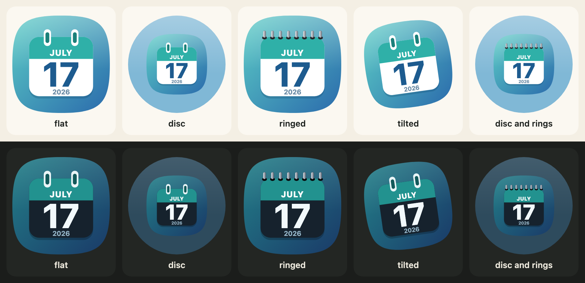
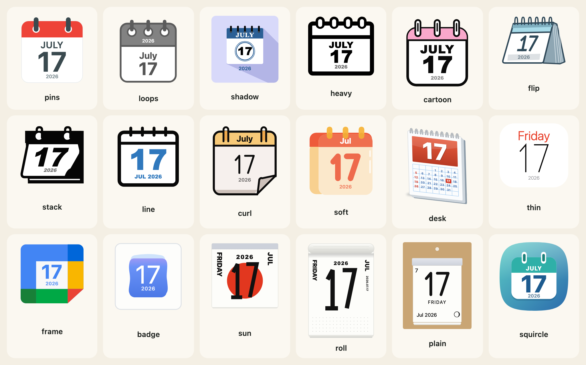
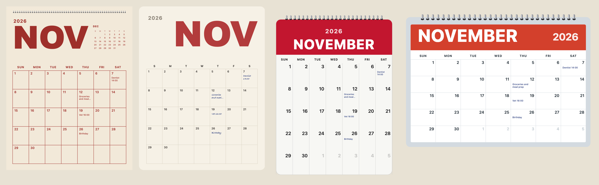

[日本語](ja/getting-started.md)

Koyomi Calendars draws calendar pages as SVG text. You give it a date; it gives back a string you can put in a page, save as a file or hand to a server. There is no image, no font file and no dependency, and the library never reads the clock: the date is always your argument.



## Install

```sh
npm install @johnmorrisdotca/koyomi-calendars
```

It needs Node 22 or later, or any current browser. Everything is an ES module with its types.

## One day as an icon

```js
import { calendarIcon } from "@johnmorrisdotca/koyomi-calendars";

const svg = calendarIcon({ theme: "squircle", month: 11, day: 2, year: 2026, scheme: "dark" });
console.log(svg.startsWith("<svg"));
console.log(svg.includes('aria-label="Monday Nov 2 2026"'));
// true
// true
```

The result is an SVG string with a `title` and an `aria-label`. Put it in the page with `innerHTML`, write it to a `.svg` file, or inline it in a server-rendered page. `year` is optional: with it the icon names the weekday (and shows a small year on the designs that have room); without it both are left off.

## Choose among the 18 designs

`theme` picks one of 18 designs; `scheme` picks `"light"` or `"dark"`. The list is data, so you can build a menu from it:

```js
import { CALENDAR_THEMES, CALENDAR_THEME_LABELS } from "@johnmorrisdotca/koyomi-calendars";

console.log(CALENDAR_THEMES.length);
console.log(CALENDAR_THEMES.slice(0, 4).map((name) => CALENDAR_THEME_LABELS[name].en).join(", "));
// 18
// Pins, Loops, Long shadow, Heavy
```



The full list, with what each one looks like, is in [Icons and designs](icons-and-designs.md).

## A frame and a turn

`housing`, `rings` and `turn` change the whole icon without touching a design's drawing:

```js
import { calendarIcon } from "@johnmorrisdotca/koyomi-calendars";

const round = calendarIcon({ theme: "badge", month: 3, day: 9, housing: "circle", rings: true, turn: -8 });
console.log(round.includes("<circle"));
console.log(round.includes("rotate(-8"));
// true
// true
```

## A whole month

`monthCalendar` is a separate import, so the small icon never carries it:

```js
import { monthCalendar } from "@johnmorrisdotca/koyomi-calendars/month";

const svg = monthCalendar({ year: 2026, month: 11, design: "poster", weekStart: "monday", notes: { "11-07": "Dentist 14:00" } });
console.log(svg.includes("Dentist"));
console.log(svg.includes('aria-label="November 2026"'));
// true
// true
```



## Turn the page

In a browser, `flipCalendar` turns the icon from one day to the next. It needs an element and a function that draws a date:

```js no-run
import { flipCalendar, nextDay } from "@johnmorrisdotca/koyomi-calendars/animate";
import { calendarIcon } from "@johnmorrisdotca/koyomi-calendars/themes/squircle";

const element = document.querySelector("#today");
const from = { year: 2026, month: 12, day: 31 };
element.innerHTML = calendarIcon({ ...from });
await flipCalendar(element, { render: (date) => calendarIcon({ ...date }), from, to: nextDay(from), animation: "tear-down" });
```

## Where to go next

- Every option of the icon: [Icons and designs](icons-and-designs.md) and [Housing, rings and turn](looks.md).
- Months: [Month pages](month-pages.md). Page turning: [Turning the page](turning-the-page.md).
- Japanese holidays, old calendar and the six-day cycle: [The Japanese calendar](japanese-calendar.md).
- Using it from React, Vue, Svelte, Angular or a server: [Frameworks and servers](frameworks.md).
- Try it with your eyes: the [demo](https://johnmorrisdotca.github.io/koyomi-calendars/) and the [builder](https://johnmorrisdotca.github.io/koyomi-calendars/builder.html). Both end in the family's "Put it in your page" panel: the code for a page, one design alone, a file on a server, plain HTML, React, Vue, Angular, Svelte and an iframe, at four sizes, with the picture beside it.
