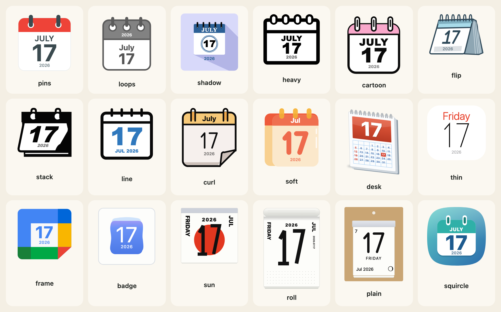
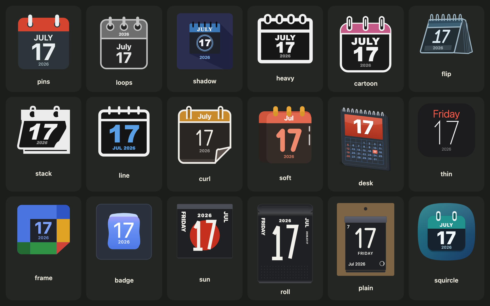
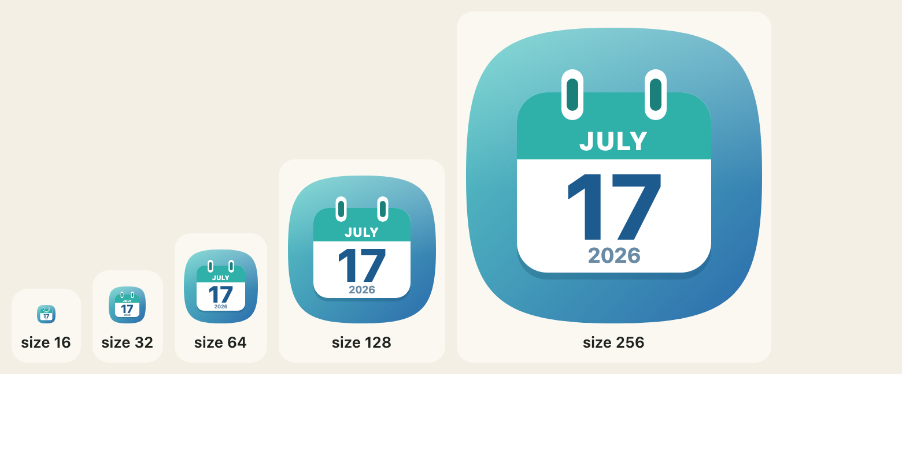

[日本語](ja/icons-and-designs.md)

`calendarIcon` draws one day as an SVG string. It takes an options object; only `month` and `day` are required.




## The options

| Option | Meaning |
|---|---|
| `month`, `day` | Month 1 to 12 and day 1 to 31. Required. |
| `year` | Four digits. Names the weekday and a small year where a design draws them; leave it out to leave both off. |
| `theme` | One of the 18 designs. Default `pins`. |
| `scheme` | `"light"` (the default) or `"dark"`. |
| `size` | Width in CSS pixels; the height follows the design. Default 96. |
| `locale` | `en` or any locale `Intl` accepts. |
| `housing`, `housingColour`, `rings`, `turn`, `preset` | The frame: see [Housing, rings and turn](looks.md). |
| `weekend`, `holidays`, `japanese`, `columns`, `mark`, `moon` | The tear-off pages: see [The Japanese calendar](japanese-calendar.md). |

## The 18 designs

| Name | Label | Look |
|---|---|---|
| `pins` | Pins | flat page, red header, two slate pins |
| `loops` | Loops | grey outline, three ring pins |
| `shadow` | Long shadow | blue header on a lavender tile, long shadow |
| `heavy` | Heavy | heavy black outline, ring slots |
| `cartoon` | Cartoon | black outline, pink header, glossy number |
| `flip` | Flip | a flip calendar in perspective |
| `stack` | Stack | solid black glyph, tilted page, a sheet underneath |
| `line` | Line | black line art with a blue number |
| `curl` | Curl | orange header, two hooks, a curled corner |
| `soft` | Soft | red-orange header, amber rings, a coral number |
| `desk` | Desk | a desk pad with a month of small dates |
| `thin` | Thin | a white page, the weekday in red, a very thin number |
| `frame` | Frame | four coloured sides round a pale square |
| `badge` | Badge | a white tile and a soft blue page |
| `sun` | Sun disc | a tear-off page with a huge day over a red disc |
| `roll` | Wall roll | a tall wall tear-off page |
| `plain` | Plain | a plain tear-off pad on a kraft stand, with the moon |
| `squircle` | Squircle | a soft rounded tile in a teal-to-blue gradient, a white page with two binding tabs, a large bold day |

Every drawing is the package's own: shapes, gradients and a stroke-drawn digit set. There is no image, no font file, no logo and no company's name in a design.

## Choosing by name

The names are in `CALENDAR_THEMES`, their labels in English and Japanese in `CALENDAR_THEME_LABELS`. `calendarThemeOf` turns text from a form or an address into a design, or `null`. The ten names of the first release (`classic`, `outline`, `spiral` and so on) are in `CALENDAR_THEME_ALIASES`, and each reads as the design that replaced it.

```js
import { CALENDAR_THEME_ALIASES, CALENDAR_THEME_LABELS, calendarIcon, calendarThemeOf } from "@johnmorrisdotca/koyomi-calendars";

console.log(calendarThemeOf("squircle"));
console.log(calendarThemeOf("classic"));
console.log(calendarThemeOf("nope"));
console.log(Object.keys(CALENDAR_THEME_ALIASES).length);
console.log(CALENDAR_THEME_LABELS.sun.en);
const svg = calendarIcon({ theme: calendarThemeOf("tile") ?? "squircle", month: 7, day: 17, year: 2026, size: 120 });
console.log(svg.includes('width="120"'));
// squircle
// pins
// null
// 10
// Sun disc
// true
```

## One design alone

Each design is also its own import, which carries none of the others, and which exports `calendarIcon` (and `theme`, the design's own definition, for tests and tools):

```js
import { calendarIcon } from "@johnmorrisdotca/koyomi-calendars/themes/squircle";

const svg = calendarIcon({ month: 11, day: 2 });
console.log(svg.startsWith("<svg"));
// true
```

See [Sizes and bundles](sizes-and-bundles.md) for what that saves.

## Size

`size` is the width in CSS pixels, 16 to 1024, and the height follows the design. Every design is drawn to stay readable down to the small end: the day number is the largest thing on the page.



## What the year does

With a `year`, an icon names the weekday ("Monday") and the designs with room show a small year. The year chip keeps a minimum size and a margin from the bottom of its page: `CALENDAR_YEAR_MIN` (0.07 of the width) and `CALENDAR_YEAR_CLEAR` (0.03). `calendarLayout(theme, withYear)` says where the day sits and where the year zone is, in the design's own units, if you need to place something beside an icon.

```js
import { CALENDAR_YEAR_CLEAR, CALENDAR_YEAR_MIN, calendarLayout } from "@johnmorrisdotca/koyomi-calendars";

console.log(CALENDAR_YEAR_MIN, CALENDAR_YEAR_CLEAR);
console.log(JSON.stringify(calendarLayout("squircle", true).page));
console.log(JSON.stringify(calendarLayout("squircle", false).yearZone));
// 0.07 0.03
// [44,118,168,94]
// [44,118,168,94]
```

## Bad input

`calendarIcon` checks its options and throws a `RangeError` that names the one that is wrong: a month that is not a whole number from 1 to 12, a day that is not a whole number from 1 to 31, an unknown `theme`, a `size` outside 16 to 1024, a `turn` beyond 45 degrees either way. It checks the range of a day, not the length of its month: if a date must be real, ask `daysInMonth` from [Month pages](month-pages.md) first.

```js
import { calendarIcon } from "@johnmorrisdotca/koyomi-calendars";

for (const options of [{ month: 13, day: 1 }, { month: 1, day: 1, theme: "nope" }, { month: 1, day: 1, turn: 60 }]) {
  try {
    calendarIcon(options);
  } catch (error) {
    console.log(error instanceof RangeError, error.message);
  }
}
// true month must be an integer 1–12
// true unknown calendar theme: nope
// true turn must be between -45 and 45 degrees
```
