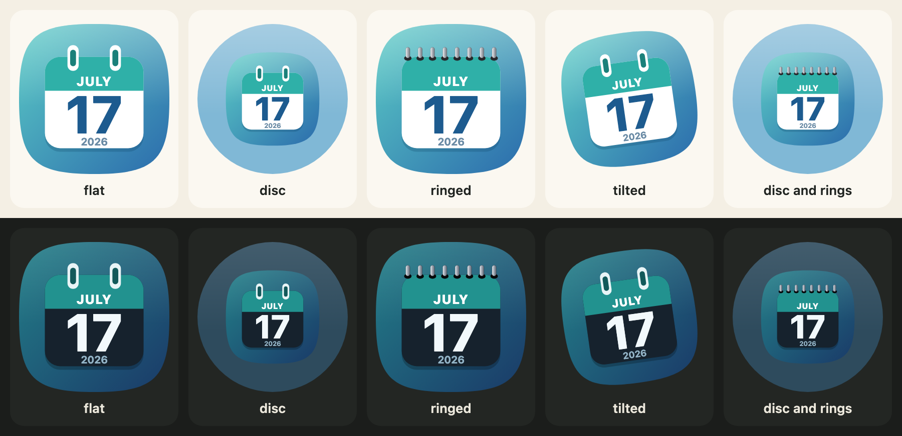
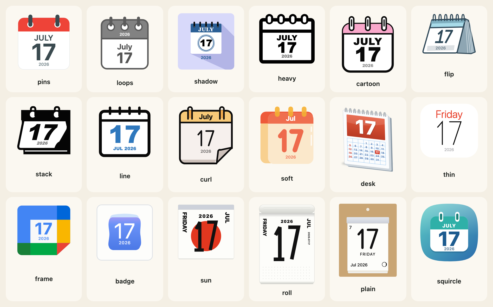
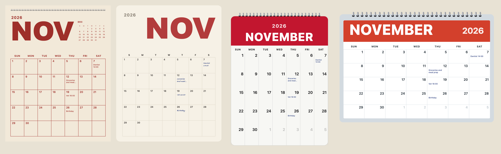

[English](../getting-started.md)

Koyomi Calendarsは、カレンダーのページをSVGの文字列として描きます。日付を渡すと、ページに入れても、ファイルに保存しても、サーバーに渡してもよい文字列が返ります。画像もフォントファイルも依存もなく、ライブラリが時計を読むこともありません。日付はいつも、呼び出す側が渡す引数です。



## インストール

```sh
npm install @johnmorrisdotca/koyomi-calendars
```

Node 22以降、または最近のブラウザーで動きます。すべてESモジュールで、型も付いています。

## 1日分のアイコン

```js
import { calendarIcon } from "@johnmorrisdotca/koyomi-calendars";

const svg = calendarIcon({ theme: "squircle", month: 11, day: 2, year: 2026, scheme: "dark" });
console.log(svg.startsWith("<svg"));
console.log(svg.includes('aria-label="Monday Nov 2 2026"'));
// true
// true
```

結果は、`title`と`aria-label`を持つSVGの文字列です。`innerHTML`でページに入れる、`.svg`ファイルに書き出す、サーバーで描くページに埋め込む、のどれでも使えます。`year`は省略できます。渡すと曜日が付き、余裕のあるデザインでは小さな年も描かれます。省略すると、どちらも描かれません。

## 18種類のデザインから選ぶ

`theme`で18種類のデザインのひとつを、`scheme`で`"light"`か`"dark"`を選びます。一覧はデータなので、メニューも作れます。

```js
import { CALENDAR_THEMES, CALENDAR_THEME_LABELS } from "@johnmorrisdotca/koyomi-calendars";

console.log(CALENDAR_THEMES.length);
console.log(CALENDAR_THEMES.slice(0, 4).map((name) => CALENDAR_THEME_LABELS[name].en).join(", "));
// 18
// Pins, Loops, Long shadow, Heavy
```



デザインの一覧と見た目は、[アイコンとデザイン](icons-and-designs.md)にあります。

## 枠と傾き

`housing`、`rings`、`turn`は、デザイン自身の絵には手を加えず、アイコン全体を変えます。

```js
import { calendarIcon } from "@johnmorrisdotca/koyomi-calendars";

const round = calendarIcon({ theme: "badge", month: 3, day: 9, housing: "circle", rings: true, turn: -8 });
console.log(round.includes("<circle"));
console.log(round.includes("rotate(-8"));
// true
// true
```

## 月間カレンダー

`monthCalendar`は別のインポートなので、小さなアイコンには含まれません。

```js
import { monthCalendar } from "@johnmorrisdotca/koyomi-calendars/month";

const svg = monthCalendar({ year: 2026, month: 11, design: "poster", weekStart: "monday", notes: { "11-07": "Dentist 14:00" } });
console.log(svg.includes("Dentist"));
console.log(svg.includes('aria-label="November 2026"'));
// true
// true
```



## ページをめくる

ブラウザーでは、`flipCalendar`でアイコンを次の日へめくれます。要素と、日付を描く関数を渡します。

```js no-run
import { flipCalendar, nextDay } from "@johnmorrisdotca/koyomi-calendars/animate";
import { calendarIcon } from "@johnmorrisdotca/koyomi-calendars/themes/squircle";

const element = document.querySelector("#today");
const from = { year: 2026, month: 12, day: 31 };
element.innerHTML = calendarIcon({ ...from });
await flipCalendar(element, { render: (date) => calendarIcon({ ...date }), from, to: nextDay(from), animation: "tear-down" });
```

## 次に読むもの

- アイコンのすべてのオプション：[アイコンとデザイン](icons-and-designs.md)と[枠・リング・傾き](looks.md)
- 月間カレンダー：[月間カレンダー](month-pages.md)。ページめくり：[ページをめくる](turning-the-page.md)
- 日本の祝日、旧暦、六曜：[日本の暦](japanese-calendar.md)
- React、Vue、Svelte、Angular、サーバーでの使い方：[フレームワークとサーバー](frameworks.md)
- 目で試す：[デモ](https://johnmorrisdotca.github.io/koyomi-calendars/ja/)と[ビルダー](https://johnmorrisdotca.github.io/koyomi-calendars/ja/builder.html)。どちらも最後はファミリー共通の「自分のページに入れる」パネルです。ページ用、デザイン1つだけ、サーバー上のファイル、HTML、React、Vue、Angular、Svelte、iframe のコードを、4つの大きさで、横の絵といっしょに見られます
