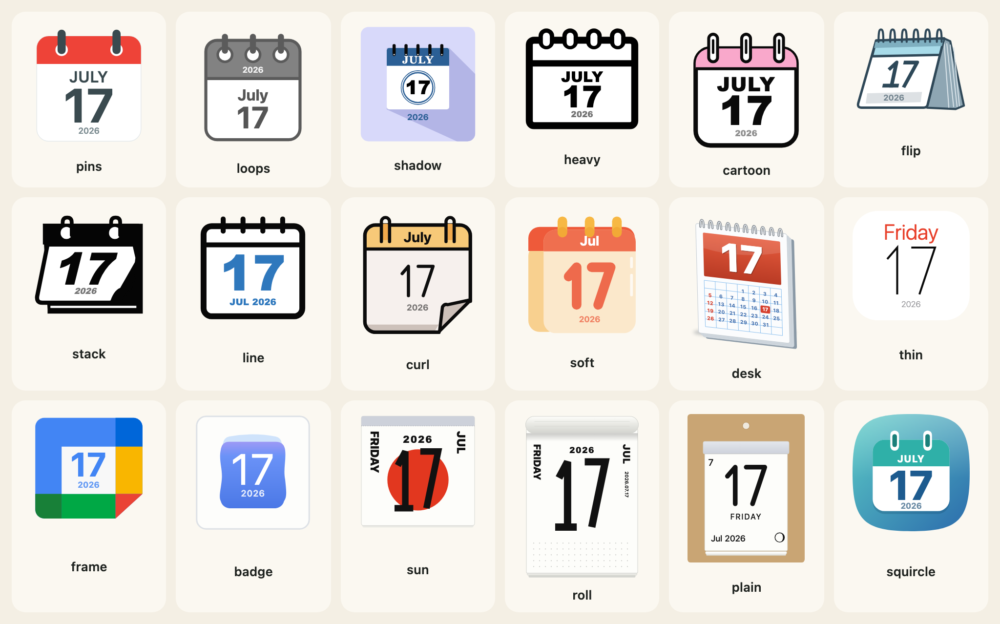
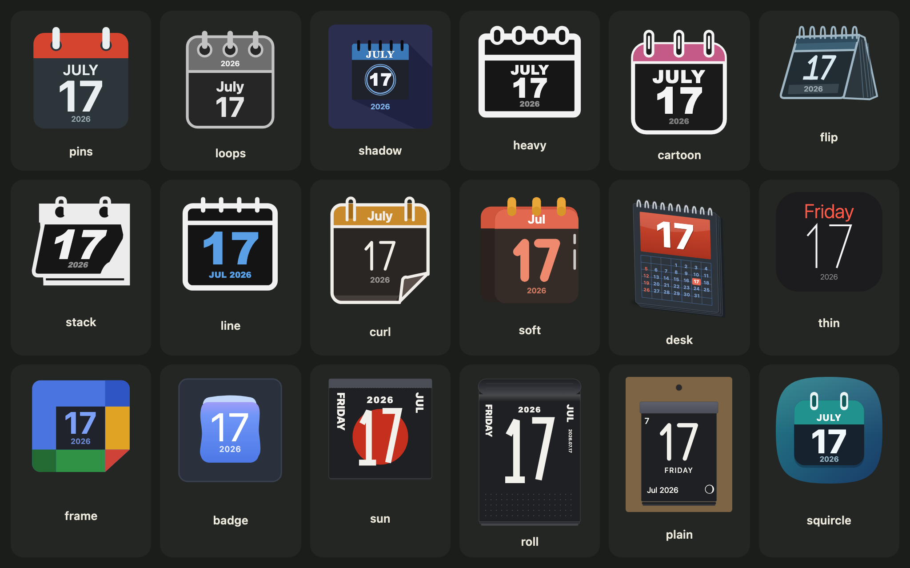
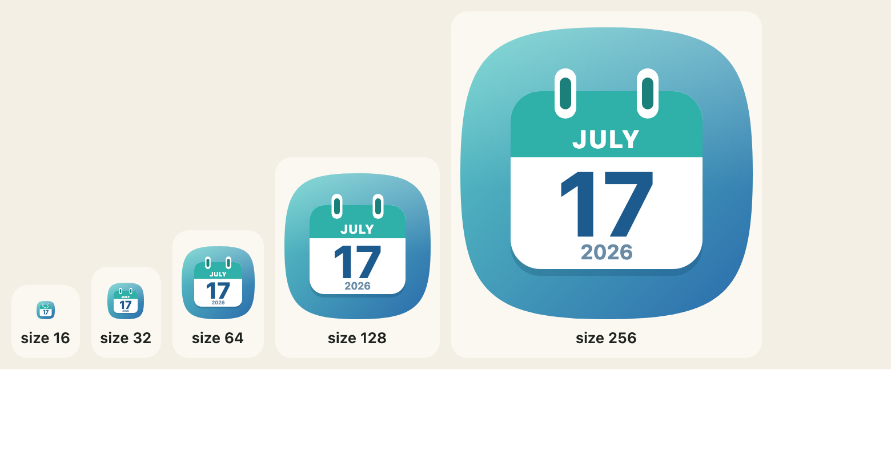

[English](../icons-and-designs.md)

`calendarIcon`は、1日分をSVGの文字列として描きます。オプションのオブジェクトを受け取り、必須なのは`month`と`day`だけです。




## オプション

| オプション | 意味 |
|---|---|
| `month`、`day` | 月（1から12）と日（1から31）。必須。 |
| `year` | 4桁の年。渡すと曜日が付き、余裕のあるデザインでは小さな年も描かれます。省略すると、どちらも描かれません。 |
| `theme` | 18種類のデザインのひとつ。初期値は`pins`。 |
| `scheme` | `"light"`（初期値）か`"dark"`。 |
| `size` | 幅（CSSピクセル）。高さはデザインに合わせて決まります。初期値は96。 |
| `locale` | `en`、または`Intl`が受け付ける任意のロケール。 |
| `housing`、`housingColour`、`rings`、`turn`、`preset` | 枠：[枠・リング・傾き](looks.md)を参照。 |
| `weekend`、`holidays`、`japanese`、`columns`、`mark`、`moon` | 日めくりのページ：[日本の暦](japanese-calendar.md)を参照。 |

## 18種類のデザイン

| 名前 | ラベル | 見た目 |
|---|---|---|
| `pins` | ピン留め | 平らなページ、赤い見出し、2本のスレートグレーのピン |
| `loops` | リング綴じ | グレーの線、3つのリングピン |
| `shadow` | 長い影 | ラベンダー色のタイルに青い見出しと長い影 |
| `heavy` | 極太 | 太い黒の輪郭、リングの穴 |
| `cartoon` | マンガ風 | 黒い輪郭、ピンクの見出し、つやのある数字 |
| `flip` | フリップ | 遠近のついた卓上カレンダー |
| `stack` | 重ね | 黒く塗った形、傾いたページ、下に重なる1枚 |
| `line` | 線画 | 黒い線画と青い数字 |
| `curl` | 角めくれ | オレンジの見出し、2つのフック、めくれた角 |
| `soft` | やわらか | 赤橙の見出し、琥珀色のリング、珊瑚色の数字 |
| `desk` | 月間パッド | 小さな日付が並ぶ卓上パッド |
| `thin` | 細字 | 白いページ、赤い曜日、とても細い数字 |
| `frame` | 四色枠 | 淡い四角を囲む4色の辺 |
| `badge` | バッジ | 白いタイルと、やわらかな青いページ |
| `sun` | 日の丸 | 赤い円の上に大きな日付が載った日めくり |
| `roll` | 壁掛け日めくり | 縦長の壁掛け日めくり |
| `plain` | 無地 | 台紙つきの飾りのない日めくり。月の満ち欠け付き |
| `squircle` | 角丸タイル | 青緑から青へのグラデーションの角丸タイルに、2つの綴じ具が付いた白いページと、大きく太い日付 |

どの絵もこのパッケージ自身のものです。形、グラデーション、線で描いた数字だけでできています。画像もフォントファイルもロゴも、会社名もデザインには入っていません。

## 名前で選ぶ

名前は`CALENDAR_THEMES`に、英語と日本語のラベルは`CALENDAR_THEME_LABELS`にあります。`calendarThemeOf`は、フォームやアドレスの文字列をデザインに変換し、対応するものがなければ`null`を返します。最初のリリースの10個の名前（`classic`、`outline`、`spiral`など）は`CALENDAR_THEME_ALIASES`にあり、それぞれ置き換わったデザインとして読み替えられます。

```js
import { CALENDAR_THEME_ALIASES, CALENDAR_THEME_LABELS, calendarIcon, calendarThemeOf } from "@johnmorrisdotca/koyomi-calendars";

console.log(calendarThemeOf("squircle"));
console.log(calendarThemeOf("classic"));
console.log(calendarThemeOf("nope"));
console.log(Object.keys(CALENDAR_THEME_ALIASES).length);
console.log(CALENDAR_THEME_LABELS.sun.en);
const svg = calendarIcon({ theme: calendarThemeOf("tile") ?? "squircle", month: 7, day: 17, year: 2026, size: 120 });
console.log(svg.includes('width="120"'));
// squircle
// pins
// null
// 10
// Sun disc
// true
```

## デザイン1つだけを使う

各デザインは単独のインポートにもなっており、ほかのデザインは含まれません。`calendarIcon`と、デザイン自身の定義である`theme`（テストやツール用）をエクスポートします。

```js
import { calendarIcon } from "@johnmorrisdotca/koyomi-calendars/themes/squircle";

const svg = calendarIcon({ month: 11, day: 2 });
console.log(svg.startsWith("<svg"));
// true
```

節約できる量は、[サイズとバンドル](sizes-and-bundles.md)を参照してください。

## サイズ

`size`は幅（CSSピクセル、16から1024）で、高さはデザインに合わせて決まります。どのデザインも、小さいサイズまで読めるように描かれており、日付の数字がページで最も大きいものになっています。



## 年のはたらき

`year`を渡すと、アイコンに曜日が付き、余裕のあるデザインでは小さな年も描かれます。年の表示には、最小の大きさとページの下からの余白があります。`CALENDAR_YEAR_MIN`（幅の0.07）と`CALENDAR_YEAR_CLEAR`（0.03）です。アイコンの横に何かを置きたいときは、`calendarLayout(theme, withYear)`が、日付の位置と年の領域を、デザイン自身の単位で返します。

```js
import { CALENDAR_YEAR_CLEAR, CALENDAR_YEAR_MIN, calendarLayout } from "@johnmorrisdotca/koyomi-calendars";

console.log(CALENDAR_YEAR_MIN, CALENDAR_YEAR_CLEAR);
console.log(JSON.stringify(calendarLayout("squircle", true).page));
console.log(JSON.stringify(calendarLayout("squircle", false).yearZone));
// 0.07 0.03
// [44,118,168,94]
// [44,118,168,94]
```

## 不正な入力

`calendarIcon`はオプションを検証し、誤っているものを示す`RangeError`を投げます。1から12の整数ではない月、1から31の整数ではない日、未知の`theme`、16から1024の外にある`size`、どちら向きでも45度を超える`turn`です。検証するのは日の範囲だけで、その月の長さではありません。実在する日付であることが必要なら、[月間カレンダー](month-pages.md)の`daysInMonth`で先に確かめてください。

```js
import { calendarIcon } from "@johnmorrisdotca/koyomi-calendars";

for (const options of [{ month: 13, day: 1 }, { month: 1, day: 1, theme: "nope" }, { month: 1, day: 1, turn: 60 }]) {
  try {
    calendarIcon(options);
  } catch (error) {
    console.log(error instanceof RangeError, error.message);
  }
}
// true month must be an integer 1–12
// true unknown calendar theme: nope
// true turn must be between -45 and 45 degrees
```
