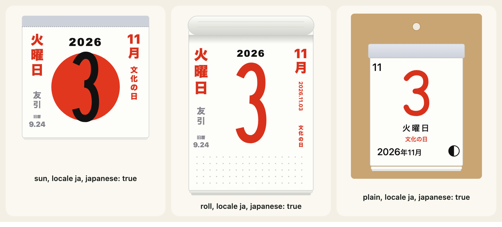
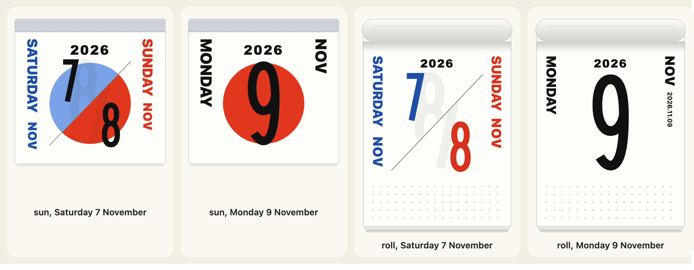

[English](../japanese-calendar.md)

このパッケージは、日本の暦に関する3つのものを、表から引くのではなく、計算して求めます。国民の祝日、旧暦、六曜です。メインのインポートにも`@johnmorrisdotca/koyomi-calendars/japanese`にも、ふつうの関数としてあり、日めくりのデザイン`sun`、`roll`、`plain`は、それらを横の列に書けます。



## 国民の祝日

`japaneseHoliday(year, month, day)`は、その日の祝日を返し、祝日でなければ`null`を返します。国民の祝日に関する法律の改正に沿っており、固定の日、ハッピーマンデーの祝日、春分の日と秋分の日（国立天文台が公表する計算式に基づくため、先の年は予測値です）、振替休日、国民の休日を扱います。対象の年は`JAPANESE_HOLIDAY_YEARS`で、その外では、誤った答えを返すより答えなしのほうがよいので、`null`を返します。

```js
import { JAPANESE_HOLIDAY_YEARS, japaneseHoliday, japaneseHolidaysOf } from "@johnmorrisdotca/koyomi-calendars/japanese";

console.log(JAPANESE_HOLIDAY_YEARS.join(" to "));
console.log(japaneseHoliday(2026, 11, 3)?.en);
console.log(japaneseHoliday(2027, 1, 1)?.en);
console.log(japaneseHoliday(2026, 11, 4));
console.log(japaneseHoliday(1999, 1, 1));
const holidays = japaneseHolidaysOf(2026);
console.log(holidays?.size);
console.log(holidays?.get("2026-05-06")?.en);
// 2000 to 2099
// Culture Day
// New Year's Day
// null
// null
// 18
// Substitute Holiday
```

`japaneseHolidaysOf(year)`は、その年全体を`YYYY-MM-DD`から、`en`と`ja`の名前を持つ祝日への`Map`として返し、対象の年の外では`null`です。[月間カレンダー](month-pages.md)にメモとして渡すのに使えます。

## 旧暦

`oldCalendarDate(year, month, day)`は、旧暦（太陰太陽暦）の日付を`{ month, day, leap }`として返します。対象は1900年から2100年（`OLD_CALENDAR_YEARS`）で、それ以外は`null`です。

```js
import { OLD_CALENDAR_YEARS, oldCalendarDate } from "@johnmorrisdotca/koyomi-calendars/japanese";

console.log(OLD_CALENDAR_YEARS.join(" to "));
console.log(JSON.stringify(oldCalendarDate(2026, 11, 2)));
console.log(oldCalendarDate(1850, 1, 1));
// 1900 to 2100
// {"month":9,"day":23,"leap":false}
// null
```

## 六曜

`rokuyoOf(year, month, day)`は、六曜（`ROKUYO`に6つとも並んでいます）のうち、その日の名前を`{ ja, reading, en }`として返します。旧暦の日付から求めるので、旧暦が求められない場合は`null`です。

```js
import { ROKUYO, rokuyoOf } from "@johnmorrisdotca/koyomi-calendars/japanese";

console.log(ROKUYO.length);
console.log(rokuyoOf(2026, 11, 2)?.reading);
console.log(rokuyoOf(2026, 11, 2)?.en);
console.log(ROKUYO.map((item) => item.reading).join(" "));
// 6
// Senshō
// Senshō (lucky in the morning)
// Taian Shakkō Senshō Tomobiki Senbu Butsumetsu
```

## 日めくりのページで

`japanese: true`は、`sun`と`roll`の横の列に3つすべてを書きます。オブジェクトを渡せば、一部だけを選べます（例：`{ holidays: true, oldDate: false, rokuyo: true }`）。求められないマスは空のままになります。初期値ではオフなので、これを使わないで描いたページはこれまでと変わりません。`locale: "ja"`なら、言葉は日本語になります。

```js
import { calendarIcon } from "@johnmorrisdotca/koyomi-calendars";

const page = calendarIcon({ theme: "sun", month: 1, day: 1, year: 2027, locale: "ja", japanese: true });
console.log(page.includes('data-part="side"'));
const some = calendarIcon({ theme: "roll", month: 11, day: 3, year: 2026, locale: "ja", japanese: { holidays: true, oldDate: false, rokuyo: false } });
console.log(some.startsWith("<svg"));
// true
// true
```

## 週末と、自分の祝日名

`weekend: "split"`は、土曜とその次の日曜を、斜めの線で分けた1ページに描きます。対象は`sun`と`roll`で、年を渡したときの土曜か日曜だけです。それ以外の日は、ふつうの1日のページのままです。`calendarWeekend(year, month, day)`が、その2日を見つける補助関数です。



`holidays`では、自分で祝日名を付けます。日付（`"2027-01-01"`）か毎年のその日（`"01-01"`）で指定し、文字列ひとつか、言語ごとの文字列にします。自分で付けた名前は、計算された名前より優先されます。ライブラリは、日本以外の国の祝日を一切知りません。自分の名前を渡してください。

```js
import { calendarIcon, calendarWeekend } from "@johnmorrisdotca/koyomi-calendars";

console.log(JSON.stringify(calendarWeekend(2026, 11, 7)));
console.log(calendarWeekend(2026, 11, 9));
const split = calendarIcon({ theme: "sun", month: 11, day: 7, year: 2026, weekend: "split" });
console.log(split.includes('data-part="saturday"'), split.includes('data-part="sunday"'));
const named = calendarIcon({ theme: "sun", month: 7, day: 1, year: 2026, holidays: { "07-01": "Canada Day" } });
console.log(named.includes("Canada Day"));
// {"saturday":{"year":2026,"month":11,"day":7},"sunday":{"year":2026,"month":11,"day":8}}
// null
// true true
// true
```

## 日の丸、列、月

`mark`は、`sun`の日付の後ろにある赤い円を、自分のSVGの図形に置き換えます。-100,-100から100,100の枠の中に描きます。自分で書いたマークアップがそのまま出力され、スクリプト、スタイル、イベント属性、foreignObjectは使えません。`columns: false`は、`sun`と`roll`の横の列をなくします。`moon: false`は、`plain`の月の満ち欠けをなくします（年を渡すと描かれます）。`calendarMoon(year, month, day)`は、月相を、1朔望月の8分の1を単位として返します（0が新月、2が上弦、4が満月、6が下弦）。平均の朔望月を使っているため、月相の変わり目の近くでは1日ずれることがあります。

```js
import { calendarIcon, calendarMoon } from "@johnmorrisdotca/koyomi-calendars";

const phase = calendarMoon(2026, 11, 2);
console.log(phase >= 0 && phase < 8, Number.isInteger(phase));
const bare = calendarIcon({ theme: "sun", month: 5, day: 5, year: 2026, columns: false, mark: '<circle r="60" fill="#c33"/>' });
console.log(bare.includes('data-part="side"'));
// true true
// false
```

## ここにないもの

`japaneseHoliday`が計算するもの以外の、どの国の祝日もありません。月間カレンダーのメモは、利用側で渡します。[月間カレンダー](month-pages.md)を参照してください。計算の出典は、リポジトリの[NOTICE.md](../../../NOTICE.md)に書かれています。
