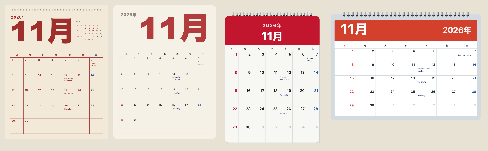

[English](../languages-and-locales.md)

パッケージには、月や曜日の名前の一覧が入っていません。名前は、`calendarIcon`か`monthCalendar`に渡す`locale`に従って、`Intl`から来ます。`en`（初期値）か、ブラウザーやNodeが知っている任意のロケールです。日本語、フランス語、アラビア語のページにも、追加のデータもバイトも要りません。



## ロケールを使う

```js
import { calendarIcon } from "@johnmorrisdotca/koyomi-calendars";

const en = calendarIcon({ theme: "pins", month: 11, day: 2, year: 2026 });
const fr = calendarIcon({ theme: "pins", month: 11, day: 2, year: 2026, locale: "fr" });
const ja = calendarIcon({ theme: "pins", month: 11, day: 2, year: 2026, locale: "ja" });
console.log(en.includes('aria-label="Monday Nov 2 2026"'));
console.log(fr.includes("lundi"));
console.log(ja.includes("2026"), ja !== en);
// true
// true
// true true
```

名前は、絵の中でも、`title`でも、`aria-label`でも変わるので、スクリーンリーダーも同じ言語で日付を読み上げます。`ja`のアイコンは、年、月、曜日を日本の書き方にします。月間カレンダーも同様で、日本語、中国語、韓国語では年が月の前に来ます。

## 未知のロケール

`Intl`が知らないロケールは、例外を投げずに英語にフォールバックします。設定を間違えても、壊れたページではなく英語のページになります。知りたいときは、自分で確かめてください。

```js
import { monthCalendar } from "@johnmorrisdotca/koyomi-calendars/month";

const wanted = "xx";
const known = Intl.DateTimeFormat.supportedLocalesOf(wanted).length > 0;
console.log(known);
const svg = monthCalendar({ year: 2026, month: 11, locale: wanted });
console.log(svg.includes("November"));
// false
// true
```

## 週の始まり

週は初期値で日曜から始まります。月間カレンダーの`weekStart: "monday"`で変えます。ロケールから週の始まりを推測しないのは、多くの地域で、その言語で一般的な週の始まりと実際が異なるからです。自分の設定から決めてください。

## ラベルの言葉

デザインのラベルは、英語と日本語で、`CALENDAR_THEME_LABELS`、`MONTH_DESIGN_LABELS`、`CALENDAR_FLIP_LABELS`にあります。どちらの言語のメニューも作れます。パッケージ自身の言葉がアイコンに入ることはありません。アイコンが言うのは日付だけです。

```js
import { CALENDAR_THEME_LABELS } from "@johnmorrisdotca/koyomi-calendars";
import { CALENDAR_FLIP_LABELS } from "@johnmorrisdotca/koyomi-calendars/animate";

console.log(CALENDAR_THEME_LABELS.squircle.en);
console.log(typeof CALENDAR_THEME_LABELS.squircle.ja);
console.log(CALENDAR_FLIP_LABELS["tear-down"].en);
// Squircle
// string
// Tear down
```

## 自分の言語での祝日とメモ

`holidays`に渡す祝日名は、文字列ひとつか、言語ごとの`{ en: "...", ja: "..." }`にでき、アイコンはそのロケールに合うほうを使います。月間カレンダーのメモは、書いた言語のままのテキストです。日本では、計算した祝日に名前が付いてきます。[日本の暦](japanese-calendar.md)を参照してください。
