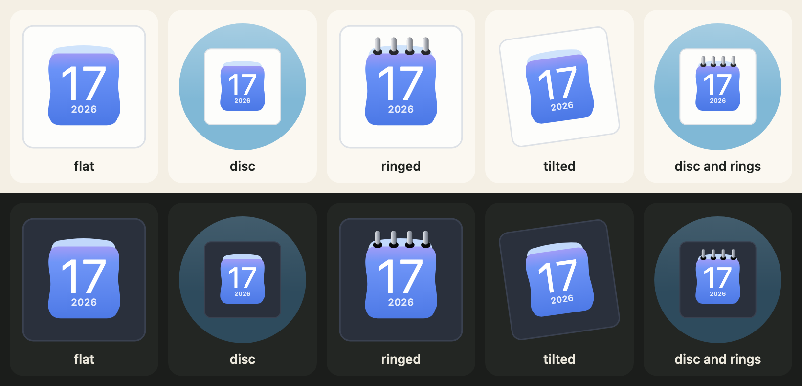

[English](../looks.md)

3つのオプション`housing`、`rings`、`turn`は、デザイン自身の絵には手を加えず、アイコン全体を変えます。どれも指定しなければ、これらのオプションがなかったときと、出力はバイト単位で同じです。そのため、プログラムにオプションを加えても、それを使わないアイコンは変わりません。



## 枠（housing）

`housing: "circle"`は、アイコンを色付きの円盤の上に載せます。初期値の`"square"`は、アイコンだけです。`housingColour`には、CSSの色を何でも指定できます。初期値はやわらかな青（ダークでは深い青）です。`CALENDAR_HOUSINGS`が2つの値を並べています。

```js
import { CALENDAR_HOUSINGS, calendarIcon } from "@johnmorrisdotca/koyomi-calendars";

console.log(CALENDAR_HOUSINGS.join(" "));
const disc = calendarIcon({ theme: "badge", month: 3, day: 9, housing: "circle", housingColour: "#335577" });
console.log(disc.includes("<circle"), disc.includes("#335577"));
const plain = calendarIcon({ theme: "badge", month: 3, day: 9 });
console.log(plain.includes("<circle"));
// square circle
// true true
// false
```

## リング（rings）

`rings: true`は、ページの上辺にスパイラルリングを描きます。もともと綴じ具のないデザイン（`badge`、`frame`、`sun`、`roll`、`plain`、`squircle`）が対象です。数（0から24）で本数を決められ、`true`ならページに合わせます。残りの12のデザインは自分の綴じ具を描くので、このオプションは無視されます。

```js
import { calendarIcon } from "@johnmorrisdotca/koyomi-calendars";

const six = calendarIcon({ theme: "squircle", month: 1, day: 1, rings: 6 });
const none = calendarIcon({ theme: "squircle", month: 1, day: 1 });
console.log(six.length > none.length);
const pins = calendarIcon({ theme: "pins", month: 1, day: 1, rings: true });
console.log(pins === calendarIcon({ theme: "pins", month: 1, day: 1 }));
// true
// true
```

## 傾き（turn）

`turn`は、アイコン全体を少し傾けます。単位は度で、正の値は時計回り、負の値は反時計回りです。昔のmacOSのアイコンのような傾きです。範囲は−45から45で、`CALENDAR_TURN_MAX`は45です。

```js
import { CALENDAR_TURN_MAX, calendarIcon } from "@johnmorrisdotca/koyomi-calendars";

console.log(CALENDAR_TURN_MAX);
console.log(calendarIcon({ month: 5, day: 5, turn: -8 }).includes("rotate(-8"));
console.log(calendarIcon({ month: 5, day: 5, turn: 0 }).includes("rotate"));
// 45
// true
// false
```

## プリセット

プリセットは、これらのオプションの組み合わせに付けた名前です。`CALENDAR_PRESETS`にあり、`flat`（何もなし）、`disc`、`ringed`、`tilted`（−8度の傾き）、`disc-ringed`です。自分で指定したオプションは、プリセットより優先されます。`calendarPresetOf`は、フォームやアドレスの文字列をプリセット名に変換し、なければ`null`を返します。

```js
import { CALENDAR_PRESETS, calendarIcon, calendarPresetOf } from "@johnmorrisdotca/koyomi-calendars";

console.log(Object.keys(CALENDAR_PRESETS).join(" "));
console.log(JSON.stringify(CALENDAR_PRESETS["disc-ringed"]));
console.log(calendarPresetOf("disc"), calendarPresetOf("nope"));
const svg = calendarIcon({ theme: "squircle", month: 1, day: 1, preset: "disc-ringed", turn: 0 });
console.log(svg.includes("rotate"));
// flat disc ringed tilted disc-ringed
// {"housing":"circle","rings":true}
// disc null
// false
```

## めくるときの枠

アイコン全体が[めくられる](turning-the-page.md)ページになるので、円盤やタイルのあるデザインでは、円盤やタイルもいっしょにめくれます。円盤を動かしたくないときは、円盤は自分で要素の後ろに描き、`housing`のないアイコンをめくってください。
