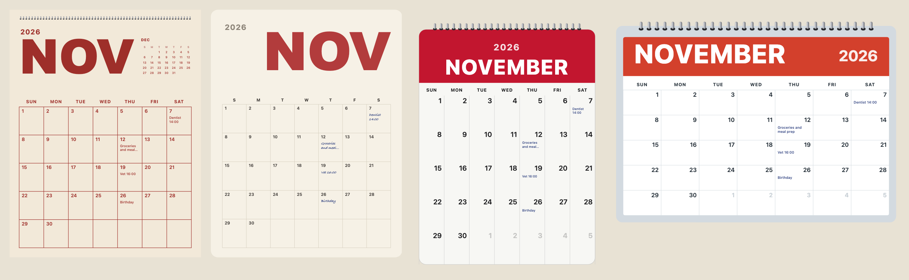
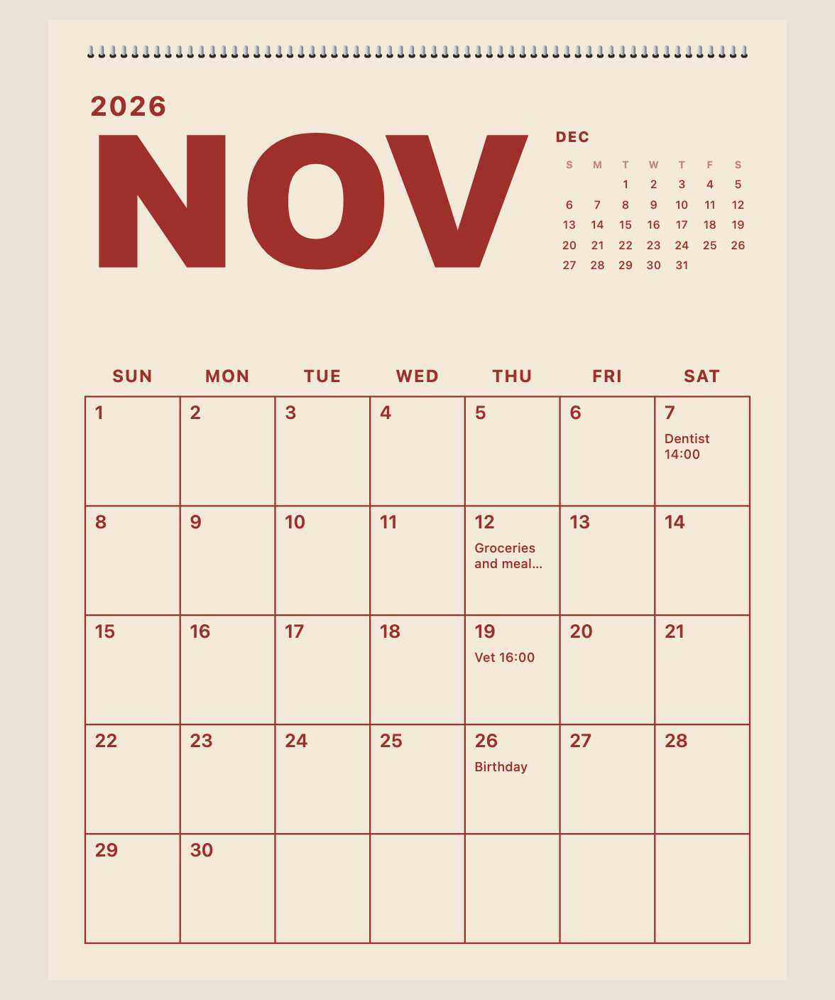
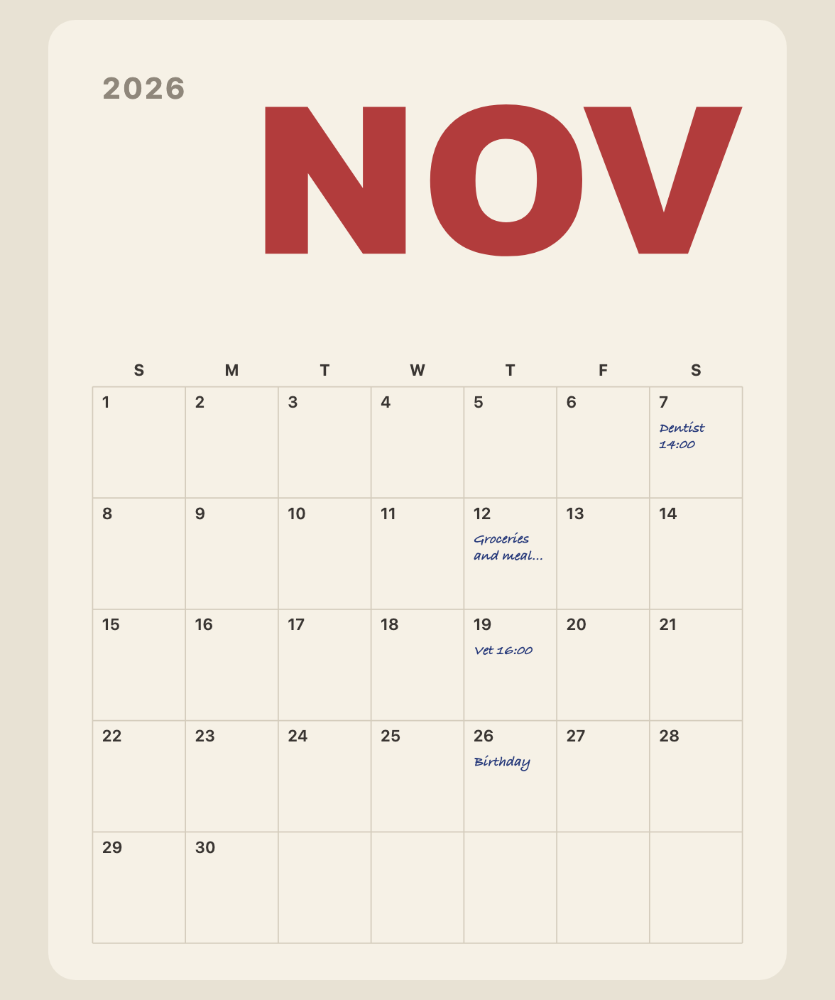
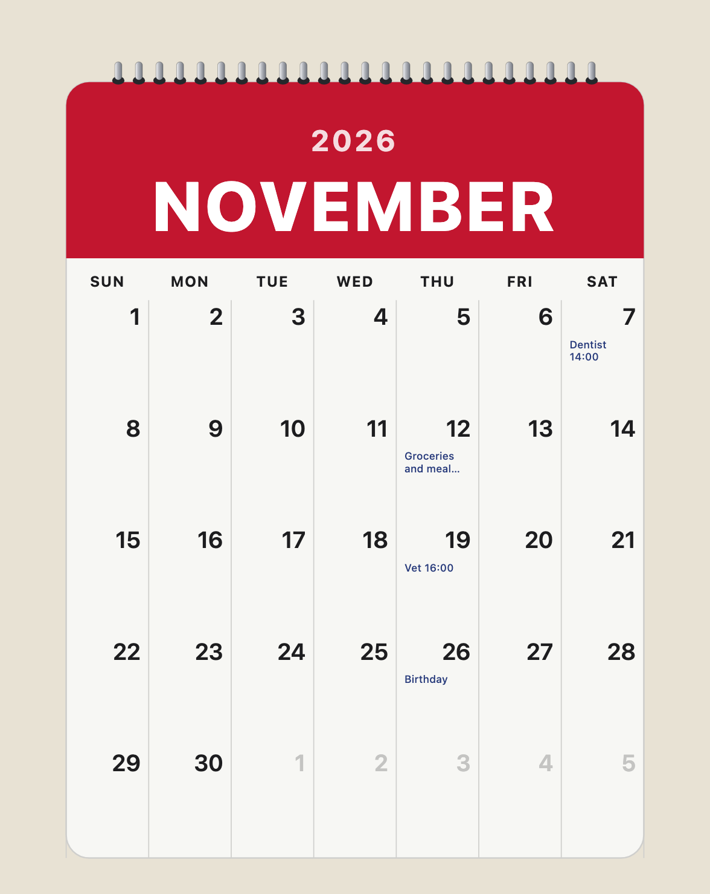
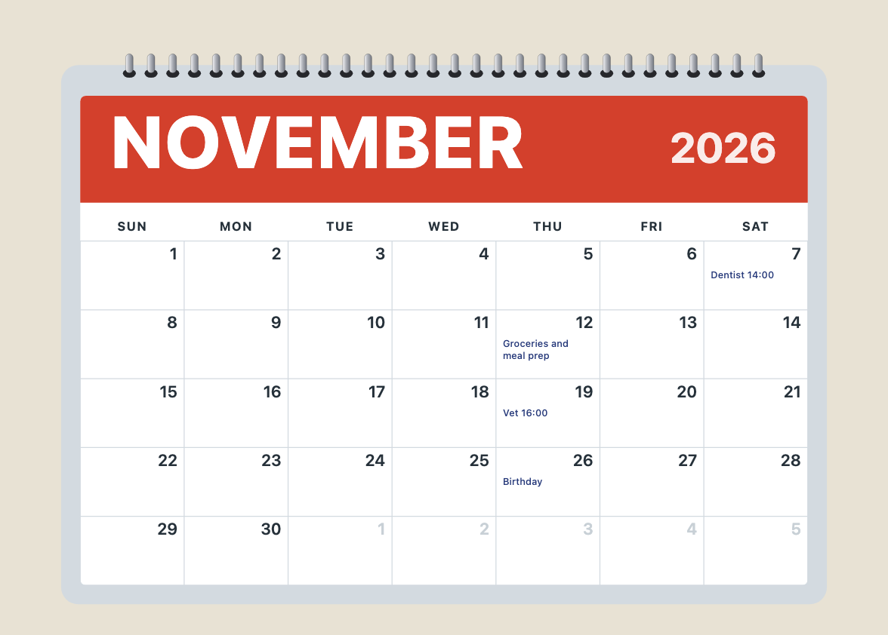
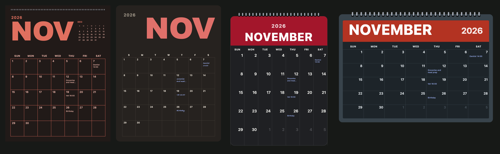
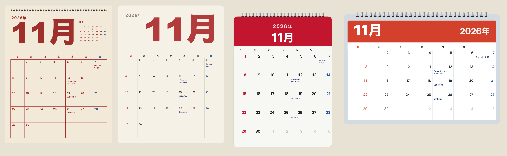

[English](../month-pages.md)

`monthCalendar`は、1か月分をひとつのSVGとして描きます。単独のインポート（`@johnmorrisdotca/koyomi-calendars/month`、約11 kB）なので、小さなアイコンには含まれません。日付は単純な算術で求め、うるう年はグレゴリオ暦の規則に従い、月や曜日の名前は`Intl`から取ります。ライブラリは祝日を一切知らないので、日ごとのメモはすべて利用側で渡します。



## 4種類のデザイン

| `design` | |
|---|---|
| `poster` | とても大きな月名、すっきりしたマス目、翌月の小さなカレンダー、書き込める余白 |
| `board` | メモボード。大きな月、控えめなマス目、手書き風のメモ |
| `wall` | 上にスパイラルの綴じ具と赤い見出しがある壁掛けのページ |
| `desk` | コイルとバナーのある横長の卓上パッド |

`MONTH_DESIGNS`が一覧、`MONTH_DESIGN_LABELS`が英語と日本語のラベルです。

```js
import { MONTH_DESIGNS, MONTH_DESIGN_LABELS, monthCalendar } from "@johnmorrisdotca/koyomi-calendars/month";

console.log(MONTH_DESIGNS.join(" "));
console.log(MONTH_DESIGN_LABELS.wall.en);
const svg = monthCalendar({ year: 2026, month: 11, design: "poster", weekStart: "monday", scheme: "light" });
console.log(svg.includes('aria-label="November 2026"'));
// poster board wall desk
// Wall page
// true
```

それぞれを大きく見ると、次のとおりです。






## オプション

| オプション | |
|---|---|
| `year`、`month` | 描く月。年は1から9999 |
| `design` | 4つのうちのひとつ。初期値は`poster` |
| `weekStart` | `"sunday"`（初期値）か`"monday"` |
| `locale` | `en`、または`Intl`が受け付ける任意のロケール。日本語、中国語、韓国語は年を月の前に置く |
| `scheme` | `"light"`か`"dark"` |
| `size` | 幅（CSSピクセル）。初期値は480 |
| `notes` | 日付ごとの短いメモ。日付（`"2026-11-07"`）か、毎年のその日（`"11-07"`）で指定。2行まで入る |
| `tint` | 土曜を青、日曜を赤に。初期値は日本語のときだけオン |
| `outside` | 前後の月の薄い日。`wall`と`desk`ではオン |
| `mini` | `poster`（オン）と`board`（オフ）の小さな翌月カレンダー |



## メモ

日付まで指定したメモは、その年だけに表示されます。`"MM-DD"`で指定したメモは毎年表示されます。マスに入りきらないメモは2行で切られ、末尾が省略記号（…）になります。

```js
import { monthCalendar } from "@johnmorrisdotca/koyomi-calendars/month";

const svg = monthCalendar({ year: 2026, month: 11, design: "board", notes: { "2026-11-07": "Dentist 14:00", "11-23": "Day off" } });
console.log(svg.includes("Dentist"));
const nextYear = monthCalendar({ year: 2027, month: 11, design: "board", notes: { "2026-11-07": "Dentist 14:00", "11-23": "Day off" } });
console.log(nextYear.includes("Dentist"), nextYear.includes("Day off"));
// true
// false true
```

ライブラリは祝日のデータを持たないので、祝日を表示したい月には、祝日をメモとして渡します。日本については、`japaneseHolidaysOf(year)`がその年の祝日を計算するので、それぞれをメモとして渡せます。[日本の暦](japanese-calendar.md)を参照してください。

## ほかの言語

`locale`には、`Intl`が知っているロケールを渡せます。月と曜日の名前が変わり、日本語、中国語、韓国語では年が月の前に来ます。日本語では、土曜と日曜に初期値で色が付きます。

```js
import { monthCalendar } from "@johnmorrisdotca/koyomi-calendars/month";

const ja = monthCalendar({ year: 2026, month: 11, design: "wall", locale: "ja" });
console.log(ja.includes("2026"));
const fr = monthCalendar({ year: 2026, month: 11, design: "wall", locale: "fr" });
console.log(fr.includes("novembre"));
// true
// true
```



## データとしての日付の表

`monthGrid`は、描画なしで週ごとの表を返します。自分のデザインを描くためのものです。7日ずつの週で、各日には年、月、日、曜日（0が日曜、6が土曜）、その月に属するかどうかがあります。`daysInMonth`はうるう年を知っています。

```js
import { daysInMonth, monthGrid } from "@johnmorrisdotca/koyomi-calendars/month";

console.log(daysInMonth(2024, 2));
console.log(daysInMonth(2100, 2));
const february = monthGrid(2026, 2, "monday");
console.log(february.weeks.length, february.offset, february.daysInMonth);
console.log(february.weeks[0][0].day, february.weeks[0][0].inMonth);
// 29
// 28
// 5 6 28
// 26 false
```
