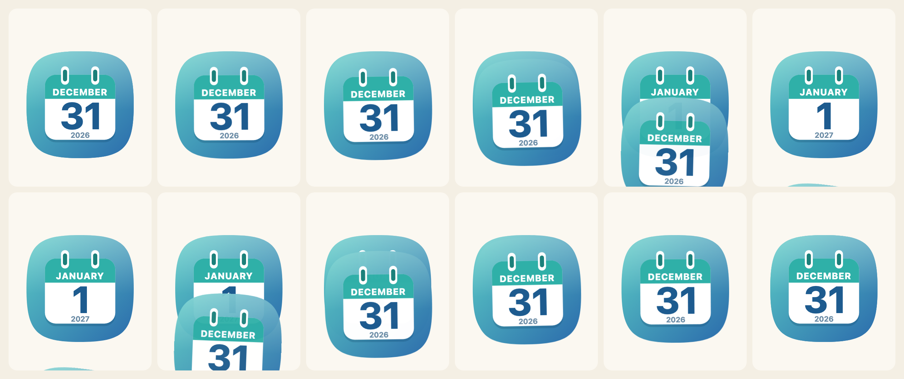
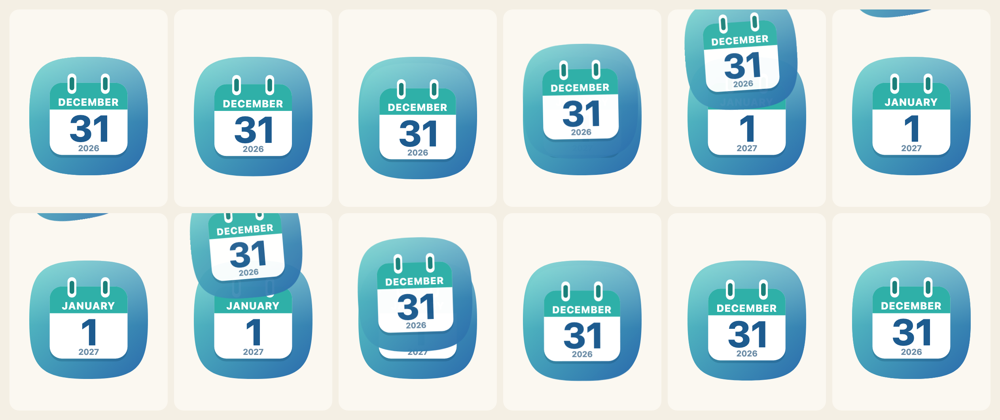

[English](../turning-the-page.md)

`flipCalendar`は、要素の中のアイコンを、次の日へ、または前の日へめくります。単独のインポート（`@johnmorrisdotca/koyomi-calendars/animate`、約3 kB）なので、描いただけのアイコンにはこれが含まれません。Web Animations APIを使うためブラウザーが必要で、ほかには何も要りません。

日付を描く関数を渡します。ライブラリ全体の`calendarIcon`でも、デザイン1つだけの`calendarIcon`でもよく、枠、リング、傾き、プリセットなどのオプションも使えます。



## 使い方

```js no-run
import { flipCalendar, nextDay } from "@johnmorrisdotca/koyomi-calendars/animate";
import { calendarIcon } from "@johnmorrisdotca/koyomi-calendars/themes/squircle";

const element = document.querySelector("#today");
const from = { year: 2026, month: 12, day: 31 };
element.innerHTML = calendarIcon({ ...from });
const shown = await flipCalendar(element, {
  render: (date) => calendarIcon({ ...date }),
  from,
  to: nextDay(from), // 2027-01-01: across the year end
  animation: "tear-down",
});
```

Promiseは、いま表示している日付で解決します。終わったとき、要素の中身はふつうに描いた1つのアイコンになっているので、後片付けは要りません。めくっている最中にもう一度めくると、最初のめくりはすぐ終わります。

## 4種類のめくり方

| `animation` | ページの動き |
|---|---|
| `tear-down` | 少し引っ張ってから、下へ引きちぎる |
| `fly-up` | 少し沈んでから、上へ飛んでいく |
| `rip-corner` | 左上の角から破り取られ、左上へ去る |
| `flip-down` | 下を軸に、遠近をつけて手前下へ倒れる |

`CALENDAR_FLIPS`が一覧、`CALENDAR_FLIP_LABELS`が英語と日本語のラベル、`FLIP_KEYFRAMES`が各動きのデータ（フレーム、原点、イージング、遠近）で、自分のコードで再生することもできます。

```js
import { CALENDAR_FLIPS, CALENDAR_FLIP_LABELS, FLIP_KEYFRAMES } from "@johnmorrisdotca/koyomi-calendars/animate";

console.log(CALENDAR_FLIPS.join(" "));
console.log(CALENDAR_FLIP_LABELS["rip-corner"].en);
console.log(FLIP_KEYFRAMES["flip-down"].perspective !== undefined, FLIP_KEYFRAMES["tear-down"].frames.length > 1);
// tear-down fly-up rip-corner flip-down
// Rip to a corner
// true true
```

戻る場合（`to`が`from`より前）は、同じ動きを逆に再生します。去ったページが元の位置に戻ってきます。アイコン全体がめくられるページなので、円盤やタイルのあるデザインでは、円盤やタイルもいっしょにめくれます。



## 日付

`nextDay`、`previousDay`、`addDays`は、月、年、うるう日をまたいで日付を進めます。`compareDays`は、2つの日付のどちらが先かを、-1、0、1で返します。

```js
import { addDays, compareDays, nextDay, previousDay } from "@johnmorrisdotca/koyomi-calendars/animate";

console.log(JSON.stringify(nextDay({ year: 2024, month: 2, day: 28 })));
console.log(JSON.stringify(nextDay({ year: 2026, month: 12, day: 31 })));
console.log(JSON.stringify(previousDay({ year: 2027, month: 3, day: 1 })));
console.log(JSON.stringify(addDays({ year: 2026, month: 1, day: 31 }, 30)));
console.log(compareDays({ year: 2026, month: 1, day: 1 }, { year: 2026, month: 1, day: 2 }));
// {"year":2024,"month":2,"day":29}
// {"year":2027,"month":1,"day":1}
// {"year":2027,"month":2,"day":28}
// {"year":2026,"month":3,"day":2}
// 1
```

## 動きの軽減

ユーザーの端末が動きの軽減（`prefers-reduced-motion`）を求めているときは、新しい日付がそのまま表示されます。`reducedMotion()`は、そうなっているかどうかを返します。`motion: "never"`は常にそうし、`motion: "always"`は設定を無視します。`"always"`は、めくること自体がページの目的であるときだけ使い、そのことを伝えてください。

## オプション

| オプション | |
|---|---|
| `render` | 日付を描いて、SVGを返す関数 |
| `from`、`to` | `{ year, month, day }`。いま表示している日付と、めくる先の日付 |
| `animation` | `CALENDAR_FLIPS`のひとつ。初期値は`tear-down` |
| `duration` | ミリ秒。初期値は650 |
| `motion` | `"auto"`（初期値）、`"never"`、`"always"` |

## 毎日のページ

今日を表示して、日付が変わったらめくるページは、数行で作れます。日付は自分のコードで読み取ります。ライブラリは時計を読みません。

```js no-run
import { flipCalendar, nextDay } from "@johnmorrisdotca/koyomi-calendars/animate";
import { calendarIcon } from "@johnmorrisdotca/koyomi-calendars/themes/plain";

const host = document.querySelector("#today");
let shown = { year: 2026, month: 11, day: 2 };
host.innerHTML = calendarIcon({ ...shown });

document.querySelector("#tomorrow").addEventListener("click", async () => {
  shown = await flipCalendar(host, { render: (date) => calendarIcon({ ...date }), from: shown, to: nextDay(shown), animation: "fly-up" });
});
```
