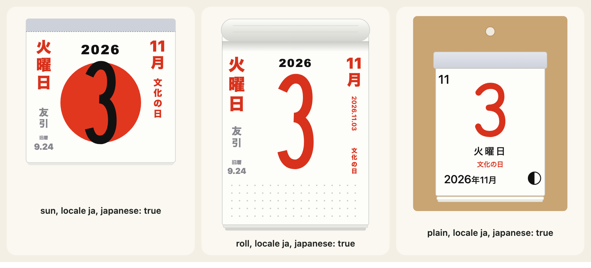
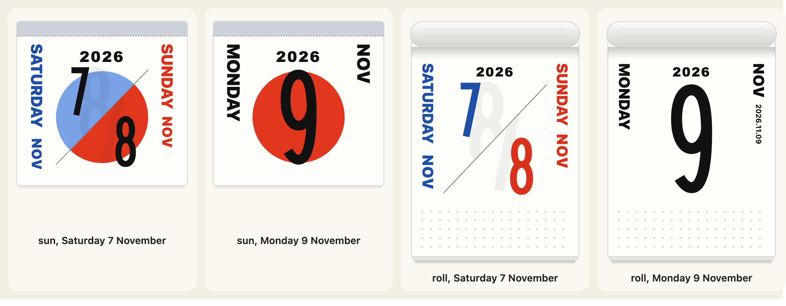

[日本語](ja/japanese-calendar.md)

The package computes three things of the Japanese calendar and never looks them up in a table: the public holidays (`国民の祝日`), the old calendar date (`旧暦`) and the day of the six-day cycle (`六曜`, rokuyō). They are plain functions in the main import and in `@johnmorrisdotca/koyomi-calendars/japanese`, and the tear-off designs `sun`, `roll` and `plain` can write them in their side columns.



## Public holidays

`japaneseHoliday(year, month, day)` gives the holiday of a date, or `null`. It follows the Act on National Holidays as amended: the fixed days, the Monday holidays, the equinox days (from the formula the National Astronomical Observatory publishes, so a far year is its prediction), the substitute holiday and the citizens' holiday between two holidays. The years it covers are `JAPANESE_HOLIDAY_YEARS`; outside them it gives `null`, because no answer is better than a wrong one.

```js
import { JAPANESE_HOLIDAY_YEARS, japaneseHoliday, japaneseHolidaysOf } from "@johnmorrisdotca/koyomi-calendars/japanese";

console.log(JAPANESE_HOLIDAY_YEARS.join(" to "));
console.log(japaneseHoliday(2026, 11, 3)?.en);
console.log(japaneseHoliday(2027, 1, 1)?.en);
console.log(japaneseHoliday(2026, 11, 4));
console.log(japaneseHoliday(1999, 1, 1));
const holidays = japaneseHolidaysOf(2026);
console.log(holidays?.size);
console.log(holidays?.get("2026-05-06")?.en);
// 2000 to 2099
// Culture Day
// New Year's Day
// null
// null
// 18
// Substitute Holiday
```

`japaneseHolidaysOf(year)` gives the whole year as a `Map` from `YYYY-MM-DD` to a holiday with an `en` and a `ja` name, or `null` outside the covered years. It is what to pass to a month page as notes.

## The old calendar

`oldCalendarDate(year, month, day)` gives the date in the old lunisolar calendar, as `{ month, day, leap }`, for 1900 to 2100 (`OLD_CALENDAR_YEARS`), or `null`.

```js
import { OLD_CALENDAR_YEARS, oldCalendarDate } from "@johnmorrisdotca/koyomi-calendars/japanese";

console.log(OLD_CALENDAR_YEARS.join(" to "));
console.log(JSON.stringify(oldCalendarDate(2026, 11, 2)));
console.log(oldCalendarDate(1850, 1, 1));
// 1900 to 2100
// {"month":9,"day":23,"leap":false}
// null
```

## The six-day cycle

`rokuyoOf(year, month, day)` gives the day's name in the cycle of six (`ROKUYO` lists them) as `{ ja, reading, en }`, worked out from the old calendar date, or `null` where that cannot be settled.

```js
import { ROKUYO, rokuyoOf } from "@johnmorrisdotca/koyomi-calendars/japanese";

console.log(ROKUYO.length);
console.log(rokuyoOf(2026, 11, 2)?.reading);
console.log(rokuyoOf(2026, 11, 2)?.en);
console.log(ROKUYO.map((item) => item.reading).join(" "));
// 6
// Senshō
// Senshō (lucky in the morning)
// Taian Shakkō Senshō Tomobiki Senbu Butsumetsu
```

## On the tear-off pages

`japanese: true` writes all three in the side columns of `sun` and `roll`; an object picks some: `{ holidays: true, oldDate: false, rokuyo: true }`. A cell the method cannot settle is left empty. It is off by default, so a page drawn without it is as before. With `locale: "ja"` the words are Japanese.

```js
import { calendarIcon } from "@johnmorrisdotca/koyomi-calendars";

const page = calendarIcon({ theme: "sun", month: 1, day: 1, year: 2027, locale: "ja", japanese: true });
console.log(page.includes('data-part="side"'));
const some = calendarIcon({ theme: "roll", month: 11, day: 3, year: 2026, locale: "ja", japanese: { holidays: true, oldDate: false, rokuyo: false } });
console.log(some.startsWith("<svg"));
// true
// true
```

## Weekends and your own holiday names

`weekend: "split"` draws a Saturday and the Sunday after it on one page, cut by a diagonal, on `sun` and `roll`, and only when a year is given and the day is a Saturday or a Sunday. Any other day keeps its own page. `calendarWeekend(year, month, day)` is the helper that finds the pair.



`holidays` names holidays yourself, by date (`"2027-01-01"`) or by day of every year (`"01-01"`), as one string or one per language. A name you give wins over the computed one. The library knows no holiday of any other country: give your own.

```js
import { calendarIcon, calendarWeekend } from "@johnmorrisdotca/koyomi-calendars";

console.log(JSON.stringify(calendarWeekend(2026, 11, 7)));
console.log(calendarWeekend(2026, 11, 9));
const split = calendarIcon({ theme: "sun", month: 11, day: 7, year: 2026, weekend: "split" });
console.log(split.includes('data-part="saturday"'), split.includes('data-part="sunday"'));
const named = calendarIcon({ theme: "sun", month: 7, day: 1, year: 2026, holidays: { "07-01": "Canada Day" } });
console.log(named.includes("Canada Day"));
// {"saturday":{"year":2026,"month":11,"day":7},"sunday":{"year":2026,"month":11,"day":8}}
// null
// true true
// true
```

## The sun's disc, the columns and the moon

`mark` replaces the red disc behind the day on `sun` with your own SVG shapes, drawn in a box from -100,-100 to 100,100: your own markup, written as given, with no scripts, styles, event attributes or foreign objects. `columns: false` leaves the side columns off `sun` and `roll`. `moon: false` leaves the moon phase off `plain`, which draws it when a year is given. `calendarMoon(year, month, day)` gives the phase in eighths of a lunation (0 new, 2 first quarter, 4 full, 6 last quarter), a mean lunation that can be a day out near the turn of a phase.

```js
import { calendarIcon, calendarMoon } from "@johnmorrisdotca/koyomi-calendars";

const phase = calendarMoon(2026, 11, 2);
console.log(phase >= 0 && phase < 8, Number.isInteger(phase));
const bare = calendarIcon({ theme: "sun", month: 5, day: 5, year: 2026, columns: false, mark: '<circle r="60" fill="#c33"/>' });
console.log(bare.includes('data-part="side"'));
// true true
// false
```

## What is not here

No holiday of any country other than what `japaneseHoliday` computes. A month page takes its notes from you: see [Month pages](month-pages.md). The sources for the computing are named in the repository's [NOTICE.md](../../NOTICE.md).
