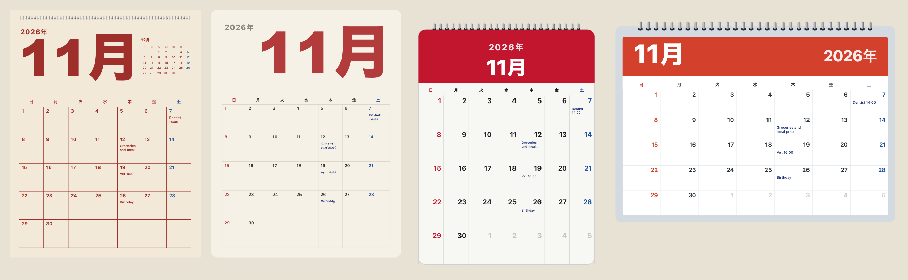

[日本語](ja/languages-and-locales.md)

The package ships no list of month or weekday names. They come from `Intl`, in the `locale` you pass to `calendarIcon` or `monthCalendar`: `en` (the default) or any locale the browser or Node knows. A page in Japanese, French or Arabic needs no extra data and no extra bytes.



## Use a locale

```js
import { calendarIcon } from "@johnmorrisdotca/koyomi-calendars";

const en = calendarIcon({ theme: "pins", month: 11, day: 2, year: 2026 });
const fr = calendarIcon({ theme: "pins", month: 11, day: 2, year: 2026, locale: "fr" });
const ja = calendarIcon({ theme: "pins", month: 11, day: 2, year: 2026, locale: "ja" });
console.log(en.includes('aria-label="Monday Nov 2 2026"'));
console.log(fr.includes("lundi"));
console.log(ja.includes("2026"), ja !== en);
// true
// true
// true true
```

The words change in the picture, in its `title` and in its `aria-label`, so a screen reader reads the date in the same language. A `ja` icon writes the year, month and weekday the Japanese way. Month pages do the same, and for Japanese, Chinese and Korean put the year before the month.

## A locale that is not known

A locale `Intl` does not know falls back to English rather than throwing, so a mistaken setting draws an English page, not a broken one. Check the locale yourself if you need to know:

```js
import { monthCalendar } from "@johnmorrisdotca/koyomi-calendars/month";

const wanted = "xx";
const known = Intl.DateTimeFormat.supportedLocalesOf(wanted).length > 0;
console.log(known);
const svg = monthCalendar({ year: 2026, month: 11, locale: wanted });
console.log(svg.includes("November"));
// false
// true
```

## Week start

Weeks start on Sunday by default; `weekStart: "monday"` on a month page changes it. The library does not guess a start from the locale, because many places differ from their language's usual choice: set it from your own settings.

## Words for the parts

The design labels in English and Japanese are in `CALENDAR_THEME_LABELS`, `MONTH_DESIGN_LABELS` and `CALENDAR_FLIP_LABELS`, for building your own menu in either language. The package's words never go in an icon: an icon says only the date.

```js
import { CALENDAR_THEME_LABELS } from "@johnmorrisdotca/koyomi-calendars";
import { CALENDAR_FLIP_LABELS } from "@johnmorrisdotca/koyomi-calendars/animate";

console.log(CALENDAR_THEME_LABELS.squircle.en);
console.log(typeof CALENDAR_THEME_LABELS.squircle.ja);
console.log(CALENDAR_FLIP_LABELS["tear-down"].en);
// Squircle
// string
// Tear down
```

## Holidays and notes in your language

A holiday name you give to `holidays` can be one string or one per language, `{ en: "...", ja: "..." }`, and the icon uses the one for its locale. Month notes are plain text in whatever language you write them. For Japan the names come with the computed holidays: see [The Japanese calendar](japanese-calendar.md).
