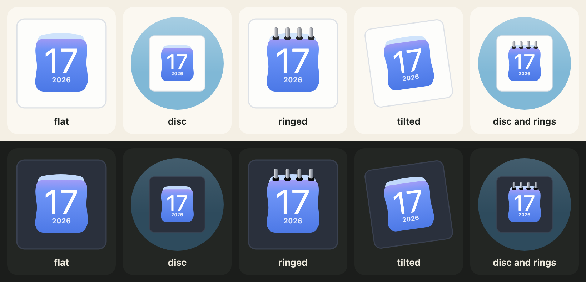

[日本語](ja/looks.md)

Three options change the whole icon and leave a design's own drawing alone: `housing`, `rings` and `turn`. With none of them set, the output is the same bytes as without them, so adding the options to a program never changes an icon that does not use them.



## Housing

`housing: "circle"` sets the icon on a coloured disc. The default, `"square"`, is the icon alone. `housingColour` takes any CSS colour; the default is a soft blue (a deep blue in dark). `CALENDAR_HOUSINGS` lists the two values.

```js
import { CALENDAR_HOUSINGS, calendarIcon } from "@johnmorrisdotca/koyomi-calendars";

console.log(CALENDAR_HOUSINGS.join(" "));
const disc = calendarIcon({ theme: "badge", month: 3, day: 9, housing: "circle", housingColour: "#335577" });
console.log(disc.includes("<circle"), disc.includes("#335577"));
const plain = calendarIcon({ theme: "badge", month: 3, day: 9 });
console.log(plain.includes("<circle"));
// square circle
// true true
// false
```

## Rings

`rings: true` draws spiral rings across the top of the page, on the designs that have no binding of their own: `badge`, `frame`, `sun`, `roll`, `plain` and `squircle`. A number from 0 to 24 sets how many; `true` fits the page. The other twelve designs ignore the option, because they draw their own binding.

```js
import { calendarIcon } from "@johnmorrisdotca/koyomi-calendars";

const six = calendarIcon({ theme: "squircle", month: 1, day: 1, rings: 6 });
const none = calendarIcon({ theme: "squircle", month: 1, day: 1 });
console.log(six.length > none.length);
const pins = calendarIcon({ theme: "pins", month: 1, day: 1, rings: true });
console.log(pins === calendarIcon({ theme: "pins", month: 1, day: 1 }));
// true
// true
```

## Turn

`turn` turns the whole icon a little, in degrees, clockwise when positive and to the left when negative, as older macOS icons stood. The range is -45 to 45, and `CALENDAR_TURN_MAX` is 45.

```js
import { CALENDAR_TURN_MAX, calendarIcon } from "@johnmorrisdotca/koyomi-calendars";

console.log(CALENDAR_TURN_MAX);
console.log(calendarIcon({ month: 5, day: 5, turn: -8 }).includes("rotate(-8"));
console.log(calendarIcon({ month: 5, day: 5, turn: 0 }).includes("rotate"));
// 45
// true
// false
```

## Presets

A preset is a name for a set of those options. `CALENDAR_PRESETS` holds them: `flat` (nothing), `disc`, `ringed`, `tilted` (a turn of -8 degrees) and `disc-ringed`. An option you give yourself wins over the preset. `calendarPresetOf` turns a name from a form or an address into a preset name, or `null`.

```js
import { CALENDAR_PRESETS, calendarIcon, calendarPresetOf } from "@johnmorrisdotca/koyomi-calendars";

console.log(Object.keys(CALENDAR_PRESETS).join(" "));
console.log(JSON.stringify(CALENDAR_PRESETS["disc-ringed"]));
console.log(calendarPresetOf("disc"), calendarPresetOf("nope"));
const svg = calendarIcon({ theme: "squircle", month: 1, day: 1, preset: "disc-ringed", turn: 0 });
console.log(svg.includes("rotate"));
// flat disc ringed tilted disc-ringed
// {"housing":"circle","rings":true}
// disc null
// false
```

## The frame in the flip

The whole icon is the sheet that [turns](turning-the-page.md), so on a design with a disc or a tile, the disc or tile turns with it. If you want the disc to stay still, draw the disc yourself behind the element and flip an icon without `housing`.
