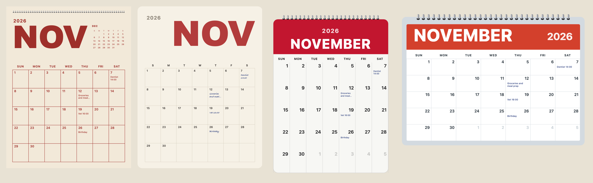
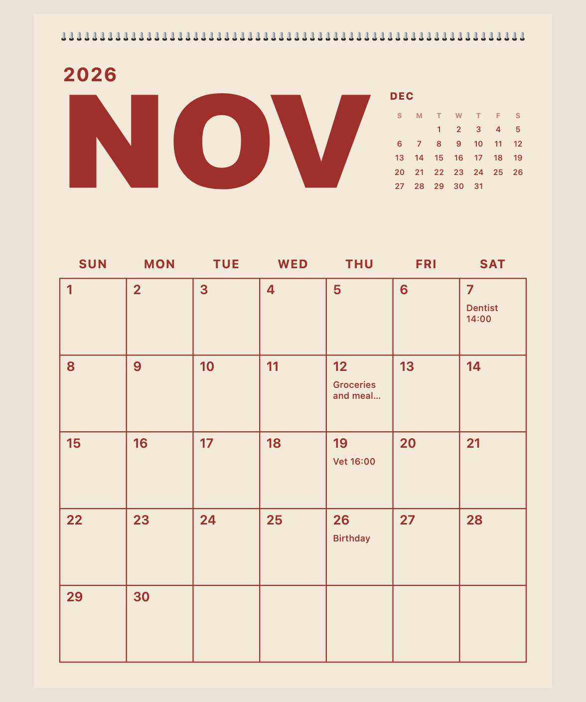
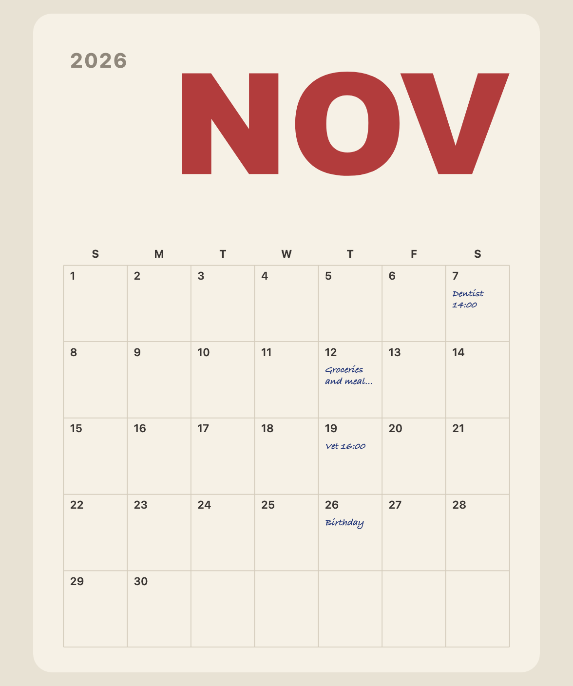
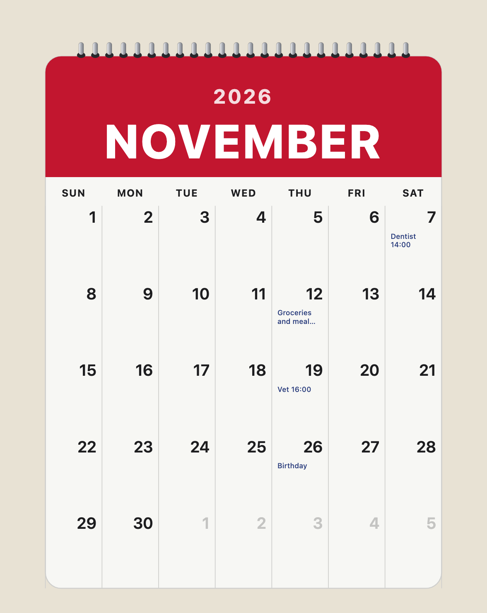
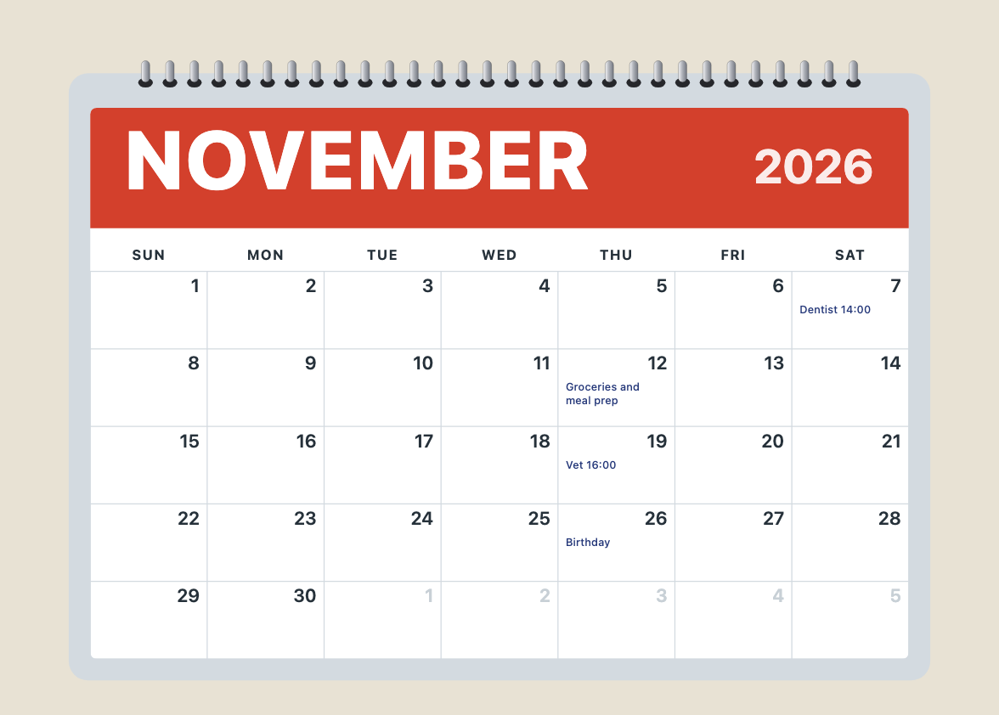
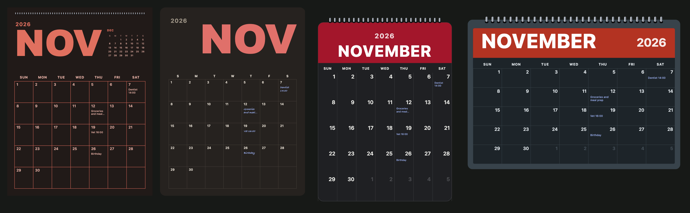
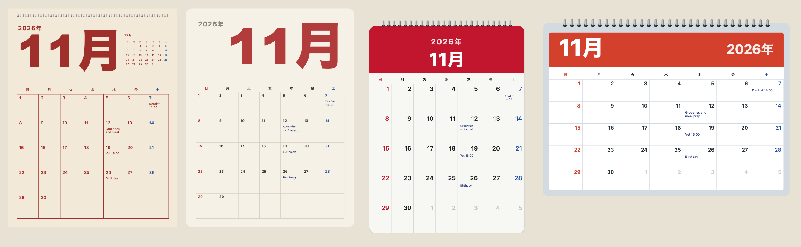

[日本語](ja/month-pages.md)

`monthCalendar` draws a whole month as one SVG. It is its own import (`@johnmorrisdotca/koyomi-calendars/month`, about 11 kB), so the small icon never carries it. Dates are plain arithmetic with leap years by the Gregorian rule, the words come from `Intl`, and the library knows no holiday: every note on a day is yours.



## The four designs

| `design` | |
|---|---|
| `poster` | a very large month word, a clean grid, a small calendar of the next month, room to write |
| `board` | a memo board: a large month, a quiet grid, handwriting-style notes |
| `wall` | a wall page with spiral binding at the top and a red header |
| `desk` | a landscape desk pad with coils and a banner |

`MONTH_DESIGNS` lists them and `MONTH_DESIGN_LABELS` has their labels in English and Japanese.

```js
import { MONTH_DESIGNS, MONTH_DESIGN_LABELS, monthCalendar } from "@johnmorrisdotca/koyomi-calendars/month";

console.log(MONTH_DESIGNS.join(" "));
console.log(MONTH_DESIGN_LABELS.wall.en);
const svg = monthCalendar({ year: 2026, month: 11, design: "poster", weekStart: "monday", scheme: "light" });
console.log(svg.includes('aria-label="November 2026"'));
// poster board wall desk
// Wall page
// true
```

Each design alone, at a larger size:






## Options

| Option | |
|---|---|
| `year`, `month` | the month to draw; any year from 1 to 9999 |
| `design` | one of the four; `poster` by default |
| `weekStart` | `"sunday"` (the default) or `"monday"` |
| `locale` | `en` or any locale `Intl` accepts; Japanese, Chinese and Korean put the year before the month |
| `scheme` | `"light"` or `"dark"` |
| `size` | width in CSS pixels; 480 by default |
| `notes` | a short note by date (`"2026-11-07"`) or for that day of every year (`"11-07"`); two lines fit |
| `tint` | Saturday blue and Sunday red; on by default for Japanese only |
| `outside` | the faint days of the months either side; on for `wall` and `desk` |
| `mini` | the small next-month calendar of `poster` (on) and `board` (off) |



## Notes

A note given by full date shows in that year only; one given as `"MM-DD"` shows every year. A note too long for its cell is cut to two lines and ends in an ellipsis.

```js
import { monthCalendar } from "@johnmorrisdotca/koyomi-calendars/month";

const svg = monthCalendar({ year: 2026, month: 11, design: "board", notes: { "2026-11-07": "Dentist 14:00", "11-23": "Day off" } });
console.log(svg.includes("Dentist"));
const nextYear = monthCalendar({ year: 2027, month: 11, design: "board", notes: { "2026-11-07": "Dentist 14:00", "11-23": "Day off" } });
console.log(nextYear.includes("Dentist"), nextYear.includes("Day off"));
// true
// false true
```

Because the library holds no holiday data, a month that should show holidays is given them as notes. For Japan, `japaneseHolidaysOf(year)` computes the year's holidays and you can pass each one as a note: see [The Japanese calendar](japanese-calendar.md).

## Other languages

`locale` takes any locale `Intl` knows. The month and weekday words change, and Japanese, Chinese and Korean put the year before the month. For Japanese, Saturdays and Sundays are tinted by default.

```js
import { monthCalendar } from "@johnmorrisdotca/koyomi-calendars/month";

const ja = monthCalendar({ year: 2026, month: 11, design: "wall", locale: "ja" });
console.log(ja.includes("2026"));
const fr = monthCalendar({ year: 2026, month: 11, design: "wall", locale: "fr" });
console.log(fr.includes("novembre"));
// true
// true
```



## The grid as data

`monthGrid` gives the weeks without any drawing, for a design of your own: whole weeks of seven days, each day with its year, month, day, weekday (0 Sunday to 6 Saturday) and whether it belongs to the month. `daysInMonth` knows leap years.

```js
import { daysInMonth, monthGrid } from "@johnmorrisdotca/koyomi-calendars/month";

console.log(daysInMonth(2024, 2));
console.log(daysInMonth(2100, 2));
const february = monthGrid(2026, 2, "monday");
console.log(february.weeks.length, february.offset, february.daysInMonth);
console.log(february.weeks[0][0].day, february.weeks[0][0].inMonth);
// 29
// 28
// 5 6 28
// 26 false
```
