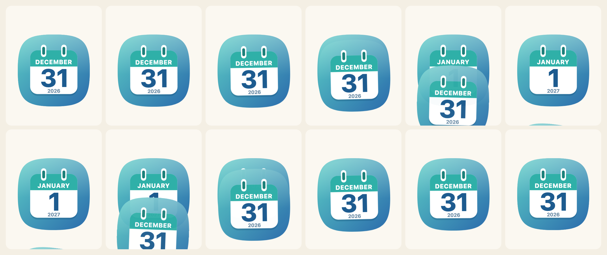
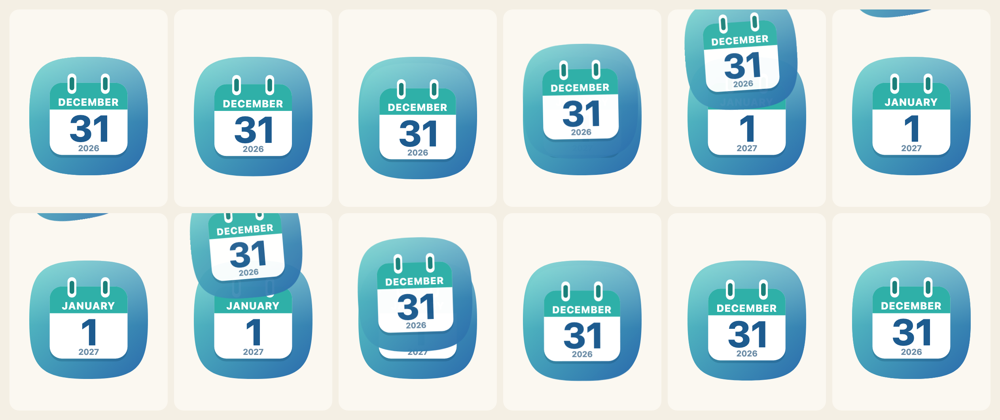

[日本語](ja/turning-the-page.md)

`flipCalendar` turns the icon in an element from one date to the next, or back to the one before. It is its own import (`@johnmorrisdotca/koyomi-calendars/animate`, about 3 kB), so a drawn icon carries none of it. It needs a browser, because it uses the Web Animations API, and nothing else.

You give it a function that draws a date. That can be `calendarIcon` from the whole library or from one design alone, with any options: housing, rings, turn, a preset.



## Use it

```js no-run
import { flipCalendar, nextDay } from "@johnmorrisdotca/koyomi-calendars/animate";
import { calendarIcon } from "@johnmorrisdotca/koyomi-calendars/themes/squircle";

const element = document.querySelector("#today");
const from = { year: 2026, month: 12, day: 31 };
element.innerHTML = calendarIcon({ ...from });
const shown = await flipCalendar(element, {
  render: (date) => calendarIcon({ ...date }),
  from,
  to: nextDay(from), // 2027-01-01: across the year end
  animation: "tear-down",
});
```

The promise resolves with the date now shown. When it is done, the element holds one plain icon, as if you had drawn it yourself, so nothing is left behind to clean up. A second flip while one is running finishes the first at once.

## The four ways

| `animation` | What the sheet does |
|---|---|
| `tear-down` | pulled down and away, with a small tug first |
| `fly-up` | dips, then flies up and away |
| `rip-corner` | rips off from its top left corner and goes up and to the left |
| `flip-down` | hinged at the bottom, it falls forward and down, in perspective |

`CALENDAR_FLIPS` lists them, `CALENDAR_FLIP_LABELS` has the labels in English and Japanese, and `FLIP_KEYFRAMES` is the motion of each as data (frames, origin, easing and perspective) if you want to play one with your own code.

```js
import { CALENDAR_FLIPS, CALENDAR_FLIP_LABELS, FLIP_KEYFRAMES } from "@johnmorrisdotca/koyomi-calendars/animate";

console.log(CALENDAR_FLIPS.join(" "));
console.log(CALENDAR_FLIP_LABELS["rip-corner"].en);
console.log(FLIP_KEYFRAMES["flip-down"].perspective !== undefined, FLIP_KEYFRAMES["tear-down"].frames.length > 1);
// tear-down fly-up rip-corner flip-down
// Rip to a corner
// true true
```

Going back (`to` earlier than `from`) plays the same motion in reverse: the page that left comes back onto the pad. The whole icon is the sheet, so on a design with a disc or a tile the disc or tile turns with it.



## Dates

`nextDay`, `previousDay` and `addDays` step a date across months, years and leap days. `compareDays` says which of two dates is first: -1, 0 or 1.

```js
import { addDays, compareDays, nextDay, previousDay } from "@johnmorrisdotca/koyomi-calendars/animate";

console.log(JSON.stringify(nextDay({ year: 2024, month: 2, day: 28 })));
console.log(JSON.stringify(nextDay({ year: 2026, month: 12, day: 31 })));
console.log(JSON.stringify(previousDay({ year: 2027, month: 3, day: 1 })));
console.log(JSON.stringify(addDays({ year: 2026, month: 1, day: 31 }, 30)));
console.log(compareDays({ year: 2026, month: 1, day: 1 }, { year: 2026, month: 1, day: 2 }));
// {"year":2024,"month":2,"day":29}
// {"year":2027,"month":1,"day":1}
// {"year":2027,"month":2,"day":28}
// {"year":2026,"month":3,"day":2}
// 1
```

## Less motion

When the reader's device asks for less motion (`prefers-reduced-motion`), the new date simply appears. `reducedMotion()` tells you whether it does. `motion: "never"` always does that, and `motion: "always"` ignores the setting. Use `"always"` only where the turn is the point of the page, and say so.

## Options

| Option | |
|---|---|
| `render` | draws a date and returns the SVG |
| `from`, `to` | `{ year, month, day }`: what is shown now, and what to turn to |
| `animation` | one of `CALENDAR_FLIPS`; `tear-down` by default |
| `duration` | milliseconds; 650 by default |
| `motion` | `"auto"` (default), `"never"` or `"always"` |

## A daily page

A page that shows today and turns at midnight is a few lines. The date is yours to read, because the library never reads the clock:

```js no-run
import { flipCalendar, nextDay } from "@johnmorrisdotca/koyomi-calendars/animate";
import { calendarIcon } from "@johnmorrisdotca/koyomi-calendars/themes/plain";

const host = document.querySelector("#today");
let shown = { year: 2026, month: 11, day: 2 };
host.innerHTML = calendarIcon({ ...shown });

document.querySelector("#tomorrow").addEventListener("click", async () => {
  shown = await flipCalendar(host, { render: (date) => calendarIcon({ ...date }), from: shown, to: nextDay(shown), animation: "fly-up" });
});
```
